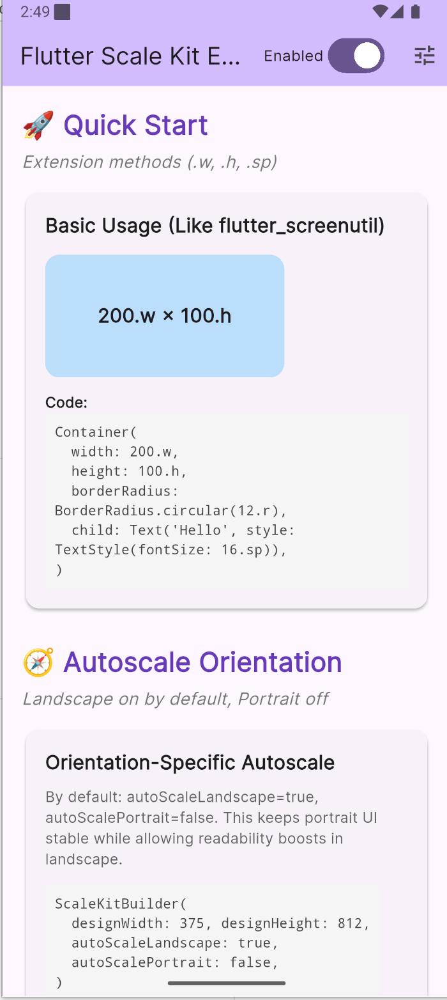
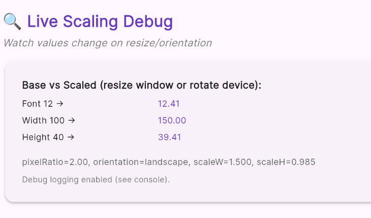
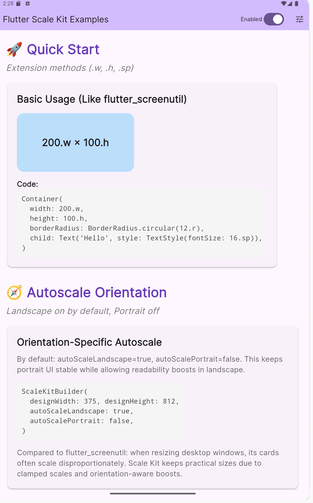
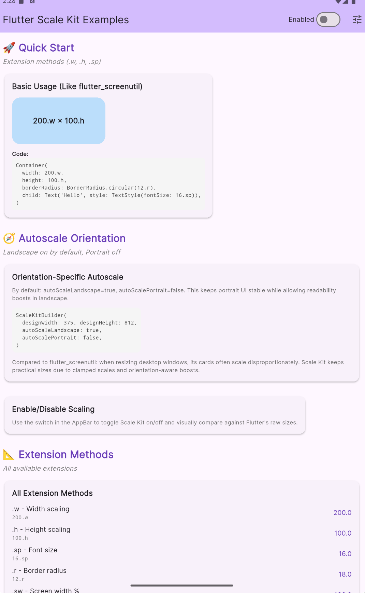

# Flutter Scale Kit

[](https://pub.dev/packages/flutter_scale_kit)
[](https://pub.dev/packages/flutter_scale_kit)
[](https://pub.dev/packages/flutter_scale_kit/score)
[](https://ko-fi.com/fodilfliti)

A high-performance responsive design package for Flutter that helps you create adaptive UIs across different screen sizes with easy-to-use scaling utilities.

<a id="key-features"></a>

## ✨ Key Features

### 🧠 Smart Scaling
- **Auto-Config**: Detects device type & screen size automatically—**works out of the box**.
- **Orientation-Aware**: Adjusts scaling when rotating (e.g., 1.2x boost in landscape).
- **Full Control**: Override breakpoints or lock desktop behavior with ease.

### 🛠️ Drop-in Widgets
- **Zero-Config**: `SKContainer`, `SKText` scale automatically without `.w`/`.h`.
- **Familiar API**: `.w`, `.h`, `.sp` work exactly like `flutter_screenutil`.
- **Design System**: Define tokens once (`ScaleKitDesignValues`) and use them everywhere.
- **Look companion**: Optional [`flutter_scale_theme_kit`](https://pub.dev/packages/flutter_scale_theme_kit) (sibling package) for colors and `ThemeData`. Independent — this package stays size-only.
- **AI Skill**: Agent skill for Cursor, Claude, Copilot, and other IDEs — init + design-system usage. If Theme Kit is in the app, the skill **uses it**.

### 📱 Cross-Platform
- **Universal**: Phones, tablets, desktop, and web support.
- **Device Helpers**: `context.isDesktop`, `DeviceMetricsMixin` for quick logic.
- **Font Intelligence**: Auto-applies Google Fonts across your app.

### ⚡ Performance
- **3x Faster**: Smart caching bypasses Map lookups for instant math.
- **Zero Leaks**: LRU cache eviction prevents memory growth.
- **Optimized Rebuilds**: Ignores keyboard/system noise.

> If this package helps you, please click "Like" on the pub.dev page — it improves discoverability and ranking.

> 💝 **Support this project**: If you find Flutter Scale Kit useful, consider [buying me a coffee](https://ko-fi.com/fodilfliti) to help me continue developing and maintaining open-source packages. Your support means a lot! 🙏

---

<a id="demo"></a>

<div align="center">

### 🎯 [**🚀 TRY LIVE DEMO NOW 🚀**](https://fodilfliti.github.io/flutter_scale_kit/)

[](https://fodilfliti.github.io/flutter_scale_kit/)
[](https://fodilfliti.github.io/flutter_scale_kit/)

**👆 Click above to test all features in your browser! 👆**

</div>

---

<a id="table-of-contents"></a>

## 📑 Table of Contents

Jump to any section:

- [📸 Screenshots](#screenshots)

### 🚀 Getting Started

- [✨ Key Features](#key-features)
- [📦 Installation](#installation)
- [🎨 Look companion (theme kit)](#look-companion)
- [🤖 AI agent skill](#ai-agent-skill)
- [🚀 Getting Started](#quick-start-guide)
- [Device Metrics Mixin](#device-metrics-mixin)
- [ScaleKitDesignValues - Centralized Design System](#scalekitdesignvalues)

### 📚 Complete API Reference

#### 📖 Core Concepts

- [Understanding Scale Limits (minScale & maxScale)](#understanding-scale-limits)
- [Understanding Orientation Boosts (Advanced)](#understanding-orientation-boosts)
- [🧠 Intelligent Auto-Configuration](#intelligent-auto-configuration)
- [⚡ Performance](#performance)

#### 🎨 Core APIs

- [Extension Methods (.w, .h, .sp, .rSafe)](#extension-methods)
- [Typography & Theme](#typography-and-theme)
- [Layout & Container Helpers (SKit)](#layout-container-helpers)
- [Spacing Widgets & Const Helpers](#spacing-widgets)

#### 🛠️ Configuration & Advanced

- [Size System Configuration](#size-system-configuration)
- [Context Extensions](#context-extensions)

#### ⚙️ Advanced Features

- [ScaleManager Direct API](#scalemanager-direct-api)

### 🧪 Optional Tools

- [Enable/Disable Scaling (Runtime Toggle)](#enable-disable-scaling)
- [Device Preview Integration (Optional)](#device-preview-integration)

### 📚 Reference

- [Architecture](#architecture)
- [Advanced Tuning Reference](#advanced-tuning-reference)
- [FAQ](#faq)

### 🤝 Community

- [Contributing](#contributing)
- [Support](#support)
- [License](#license)

---

<a id="screenshots"></a>

## Screenshots

<table style="width:100%;">
  <tr>
    <td align="center" width="40%">
      <strong>Mobile</strong><br/>
      
    </td>
    <td align="center" width="60%">
      <strong>Tablet</strong><br/>
      
    </td>
  </tr>
</table>

### Desktop


### Autoscale and Enable/Disable Examples

<table style="width:100%;">
  <tr>
    <td align="center" width="50%">
      <strong>Autoscale: Enabled</strong><br/>
      
    </td>
    <td align="center" width="50%">
      <strong>Autoscale: Disabled</strong><br/>
      
    </td>
  </tr>
  <tr>
    <td align="center" width="50%">
      <strong>Package Enabled (Scaling On)</strong><br/>
      
    </td>
    <td align="center" width="50%">
      <strong>Package Disabled (Raw Flutter)</strong><br/>
      
    </td>
  </tr>
  <tr>
    <td colspan="2" align="center" style="color:#666; font-size: 12px;">
      Use the settings (tune icon) in the example app to toggle autoscale and package enable/disable, then Save.
    </td>
  </tr>
  
</table>

<a id="installation"></a>

## Installation

Add this to your package's `pubspec.yaml` file:

```yaml
flutter:
  sdk: flutter

dependencies:
  flutter_scale_kit: ^2.0.0
```

Then run:

```bash
flutter pub get
```

Optional **look** (colors / `ThemeData`) — add the sibling package, no extra coupling in Scale Kit itself:

```yaml
dependencies:
  flutter_scale_kit: ^2.0.0
  flutter_scale_theme_kit: ^1.0.1
```

<a id="look-companion"></a>

## 🎨 Look companion (theme kit)

Scale Kit is **size**. For semantic colors, light/dark, and Material look, use **[`flutter_scale_theme_kit`](https://pub.dev/packages/flutter_scale_theme_kit)** (same author, **same folder level** as this repo: `flutter_scale_kit` + `flutter_scale_theme_kit`).

- Neither package depends on the other at runtime.
- If you add Theme Kit, **use it** (`STTheme`, `context.st`). Do not keep a second hardcoded color system.
- Define tokens once (e.g. `lib/core/design.dart`): `final appST = STTheme(colors: STColors(...), radius: const STRadius(md: 12));`
- Merge fonts under `ScaleKitBuilder` (context must see Scale Kit). **Do not** replace `theme:` with `ResponsiveThemeData.create` — that drops card/button/input themes:

```dart
import 'package:flutter/material.dart';
import 'package:flutter_scale_kit/flutter_scale_kit.dart';
import 'package:flutter_scale_theme_kit/flutter_scale_theme_kit.dart';
import 'core/design.dart'; // appST

ScaleKitBuilder(
  designWidth: 375,
  designHeight: 812,
  child: Builder(
    builder: (context) {
      return STThemeModeScope(
        builder: (context, mode) {
          return MaterialApp(
            theme: appST.light.copyWith(
              textTheme: appST.light.createResponsiveTextTheme(
                appST.light.textTheme,
              ),
            ),
            darkTheme: appST.dark.copyWith(
              textTheme: appST.dark.createResponsiveTextTheme(
                appST.dark.textTheme,
              ),
            ),
            themeMode: mode.mode,
            home: const HomePage(),
          );
        },
      );
    },
  ),
);
```

`createResponsiveTextTheme` is a **Scale Kit** extension on `ThemeData` — keep both packages in `pubspec.yaml`.

Align radius in the app: `setRadiusSizes(md: 12)` and Theme Kit `STRadius(md: 12)`.

Theme Kit skill: `npx skills add fodilfliti/flutter_scale_theme_kit`

<a id="ai-agent-skill"></a>

## 🤖 AI agent skill

Your coding agent can use Flutter Scale Kit **like a design-system expert** (init `ScaleKitBuilder`, tokens, `SK*` widgets, no double-scaling). If the app also has **`flutter_scale_theme_kit`**, the skill **uses it** for look and merges `createResponsiveTextTheme` onto `appST.light` / `appST.dark`. The skill follows the open [Agent Skills](https://agentskills.io) format, so it works in **Cursor, Claude Code, GitHub Copilot, Codex, OpenCode, Windsurf, Gemini CLI**, and other compatible tools.

### Pull it into any project

```bash
# Current project (shared with the team)
npx skills add fodilfliti/flutter_scale_kit

# All projects on this machine
npx skills add fodilfliti/flutter_scale_kit -g

# This skill only
npx skills add fodilfliti/flutter_scale_kit --skill flutter-scale-kit
```

Manual copy (if you do not use the CLI): copy `skills/flutter-scale-kit/` from this repo into your agent's skills folder (for example `.agents/skills/flutter-scale-kit/`, `.claude/skills/flutter-scale-kit/`, or `~/.cursor/skills/flutter-scale-kit/`).

Then ask:

```text
Init Flutter Scale Kit with defaults.
```

The agent **checks `scale_kit.yaml`** in your project. If that file is missing, it **asks once** which style to use (then saves the file so it does not ask again).

### Pick a style (agent will ask)

**Recommended: `design_system`** — tokens + `SK*` widgets (best of the package, still short):

```dart
SKit.paddingSize(
  all: SKSize.md,
  child: SKText('Hello', fontSize: 16),
)
```

| Style | Use when | Example |
| --- | --- | --- |
| **design_system** (recommended) | New apps, design tokens | `SKit.paddingSize(all: SKSize.md, child: SKText('Hi', fontSize: 16))` |
| **drop_in** | Fast migrate: swap `Container` → `SKContainer` | `SKContainer(width: 120, child: SKText('Hi', fontSize: 16))` |
| **extensions** | Keep Flutter widgets, ScreenUtil-like | `Container(width: 120.w, child: Text('Hi', style: TextStyle(fontSize: 16.sp)))` |
| **hybrid** | New UI = design_system, old widgets = `.w` | `SKText` + `SizedBox(width: 200.wMax(360), child: LegacyChart())` |

Say **defaults** to skip the interview (`design_system`, 375×812).

The agent writes `scale_kit.yaml` at the project root, adds the dependency, creates `lib/core/scale_kit.dart`, and wraps `main.dart` with `ScaleKitBuilder`. Later chats follow that `style` automatically.

After init: “Build this screen with Scale Kit” or “Migrate this page from ScreenUtil”.

To change style later, edit `scale_kit.yaml` or tell the agent: “Switch this project to extensions.”

Skill source: [`skills/flutter-scale-kit/`](https://github.com/fodilfliti/flutter_scale_kit/tree/master/skills/flutter-scale-kit)

Look companion skill: [`flutter_scale_theme_kit` skills](https://github.com/fodilfliti/flutter_scale_theme_kit/tree/main/skills/flutter-scale-theme-kit)

<a id="quick-start-guide"></a>

## 🚀 Getting Started

Flutter Scale Kit provides multiple ways to create responsive UIs. Whether you prefer extension methods like `.w` and `.sp`, helper widgets like `SKit.roundedContainer()`, or comprehensive text styling with `SKit.textFull()`, there's an API that fits your workflow.

> 🎯 **Quick Migration**: Migrating from an existing Flutter project? Our automatic scaling widgets are **drop-in replacements** for Flutter's built-in widgets! Use search & replace to switch:
>
> - `Container` → `SKContainer`
> - `Text` → `SKText`
> - `Padding` → `SKPadding`
> - `TextField` → `SKTextField`
> - `ElevatedButton` → `SKElevatedButton`
> - `Switch` → `SKSwitch`
> - And many more! See [Optimized Layout Widgets](#optimized-layout-widgets) for the complete list.
>
> Your existing code will work exactly the same, but now with automatic responsive scaling applied! No need to refactor or change your code structure—just swap the widget classes.
>
> 💡 **Keep using extensions**: Even inside these widgets you can still write `width: 120`, `width: 120.w`, or `width: 0.5.swClamp(200, 360)`—the package detects extension outputs automatically so there’s no double scaling.

All text-related APIs (extensions, `SKit.text*`, responsive themes) automatically apply your `FontConfig` when one is registered—otherwise they fall back to Flutter's default fonts so you can adopt the system gradually.

### Quick Setup (2 minutes)

**Step 1: Wrap your app**

Drop `ScaleKitBuilder` above your root app and pass the design size you targeted in Figma/Sketch:

```dart
import 'package:flutter/material.dart';
import 'package:flutter_scale_kit/flutter_scale_kit.dart';

class MyApp extends StatelessWidget {
  const MyApp({super.key});

  @override
  Widget build(BuildContext context) {
    // 👇 Wrap your app so every route inherits responsive scaling
    return ScaleKitBuilder(
      designWidth: 375,
      designHeight: 812,
      designType: DeviceType.mobile,
      // Optional: customize device breakpoints (defaults: 600 / 1200 / 1600 / 1920)
      // breakpoints: const ScaleBreakpoints(
      //   mobileMaxWidth: 640,
      //   tabletMaxWidth: 1180,
      //   desktopMaxWidth: 1680,
      // ),
      // Optional: lock desktop/web platforms to desktop behaviour only
      // lockDesktopPlatforms: true,
      // Optional: pick tablet/mobile variants when locked
      // lockDesktopAsTablet: true,
      // lockDesktopAsMobile: true,
      // Optional: control rebuild threshold (default: 0.05 for mobile/tablet, 0.0 for desktop/web)
      // sizeChangeThreshold: 0.01, // 1% threshold
      // sizeChangeThreshold: 0.0,   // Rebuild on any change
      child: Builder(
        builder: (context) {
          return MaterialApp(
            title: 'My App',
            // Optional: responsive theme (context must be under ScaleKitBuilder)
            theme: ResponsiveThemeData.create(
              context: context,
              colorScheme: ColorScheme.fromSeed(seedColor: Colors.deepPurple),
              useMaterial3: true,
            ),
            home: HomePage(),
          );
        },
      ),
    );
  }
}
```

> **Using Theme Kit?** See [Look companion (theme kit)](#look-companion) — use `appST.light` / `appST.dark` with `createResponsiveTextTheme`, not `ResponsiveThemeData.create` as the full `theme:`.

<a id="scalekitdesignvalues"></a>

**Step 2: Define your Design System (Optional but Recommended)**

Define your design tokens once, compute everywhere:

```dart
// 1. Define your design system (can be const)
const design = ScaleKitDesignValues(
  textSm: 12, textMd: 14, textLg: 16,
  paddingSm: 8, paddingMd: 16, paddingLg: 24,
  spacingSm: 8, spacingMd: 16, spacingLg: 24,
  radiusSm: 6, radiusMd: 12, radiusLg: 16,
);

// 2. Compute once per build/screen
final values = design.compute();

// 3. Use everywhere - all values auto-scaled
SKPadding(
  padding: values.paddingMd!,
  child: SKContainer(
    decoration: BoxDecoration(
      color: Colors.white,
      borderRadius: values.borderRadiusMd,
    ),
    child: Text('Hello', style: values.textMd),
  ),
)
```

**Why?** Performance (one calc), Consistency (centralized tokens), and Type Safety.

**Pattern**: Define once → Compute once → Use everywhere

> 💡 **Pro Tip**: You can also use `SKSize` enums directly with `SKit` widgets for consistent spacing without defining a full system:
> ```dart
> SKit.paddingSize(all: SKSize.md, child: ...); // Uses 16 (default) or your configured md value
> ```


<a id="device-metrics-mixin"></a>

**Step 3: Configure Defaults (Optional)**

Set up global defaults for padding, radius, and fonts at app startup. This allows you to define your design system's base values once and have them applied automatically across the app.

```dart
import 'package:google_fonts/google_fonts.dart';

void main() {
  // 1. Configure Design System Sizes (Optional)
  // Define what 'sm', 'md', 'lg' mean for your app
  setPaddingSizes(SizeValues.custom(xs: 4, sm: 8, md: 16, lg: 24, xl: 32, xxl: 48));
  setMarginSizes(SizeValues.custom(xs: 2, sm: 4, md: 8, lg: 12, xl: 16, xxl: 24));
  setRadiusSizes(SizeValues.custom(xs: 2, sm: 4, md: 8, lg: 12, xl: 16, xxl: 24));
  
  // 2. Set Default Values (Optional)
  // These values are used when you call SKit.padding() without arguments
  setDefaultPadding(16);
  setDefaultRadius(12);
  setDefaultMargin(8);
  
  // 3. Configure Fonts (Optional)
  // Scale Kit automatically applies these fonts to all SKit text widgets and themes
  FontConfig.instance
    // Default font for the whole app
    ..setDefaultFont(googleFont: GoogleFonts.inter)
    
    // Specific font for a language (e.g., Japanese)
    ..setLanguageFont(
      const LanguageFontConfig(
        languageCode: 'ja',
        googleFont: GoogleFonts.notoSansJp,
      ),
    )
    
    // Shared font for a language group (e.g., Arabic/Persian/Urdu)
    ..setLanguageGroupFont(
      const LanguageGroupFontConfig(
        languageCodes: ['ar', 'fa', 'ur'],
        googleFont: GoogleFonts.almarai,
      ),
    );

  runApp(const MyApp());
}
```

### Device Metrics Mixin

Need quick access to device helpers inside any `State` class without grabbing a `BuildContext`? Mix in `DeviceMetricsMixin` to get logical screen size, pixel ratio, and platform flags that stay in sync with `WidgetsBinding`.

```dart
class DashboardState extends State<Dashboard>
    with DeviceMetricsMixin<Dashboard> {
  @override
  Widget build(BuildContext context) {
    if (isDesktop) return const DesktopDashboard();
    if (isTablet) return const TabletDashboard();
    return const MobileDashboard();
  }

  @override
  void onDeviceMetricsChanged(Size previous, Size current) {
    debugPrint('Metrics changed: $current');
  }
}
```

The mixin exposes `logicalScreenSize`, `devicePixelRatio`, `isMobile`, `isTablet`, `isDesktop`, and platform-specific helpers like `isMobilePlatform`, `isDesktopPlatform`, `isWeb`, `isAndroidPlatform`, and `isIOSPlatform`. Keep using your existing responsive logic—this is just a lightweight shortcut when you need those values quickly.

> 📝 **FontConfig & responsive theme are optional:** if you never call `FontConfig` or `ResponsiveThemeData`, everything renders with Flutter's defaults. Configure them later for a complete design system (see [Typography & Theme](#typography-and-theme))—all SKit text helpers and cached styles will pick up your fonts automatically.

Need a different feel? Head to [Understanding Scale Limits](#understanding-scale-limits) for tighter or looser ranges.

### Core APIs - Pick Your Style

Once your app is wrapped with `ScaleKitBuilder`, you can start using Scale Kit in four ways:

> 💡 **New in v1.3.0:** Use automatic scaling widgets (`SKContainer`, `SKPadding`, `SKMargin`, `SKText`) that automatically apply scaling without needing extension methods! See [Optimized Layout Widgets](#optimized-layout-widgets) below.


#### 1. Extension Methods (Quick & Familiar)

```dart
Container(
  width: 200.w,      // Scaled width
  height: 100.h,     // Scaled height
  padding: EdgeInsets.all(16.w),
  decoration: BoxDecoration(
    borderRadius: BorderRadius.circular(12.rSafe),
  ),
  child: Text(
    'Hello World',
    style: TextStyle(fontSize: 16.sp),  // Scaled font size
  ),
)

// Math constraint extensions (cached for performance)
Container(
  width: 200.wMax(300),           // Scaled width, max 300
  height: 100.hClamp(50, 150),    // Scaled height, clamped 50-150
  decoration: BoxDecoration(
    borderRadius: BorderRadius.circular(12.rClamp(8, 20)),  // Radius clamped 8-20
  ),
  child: Text(
    'Constrained Text',
    style: TextStyle(fontSize: 16.spClamp(12, 24)),  // Font size clamped 12-24
  ),
)

// Apply .w / .h / .r directly on insets, constraints, and radii
final padding = EdgeInsets.only(left: 12, right: 12).w;     // EdgeInsets.only(left: 12.w, right: 12.w)
final rtlPadding = EdgeInsetsDirectional.only(start: 16).h; // Direction-aware, uses height scaling
final constraints = BoxConstraints(maxWidth: 200, minHeight: 80).r; // Radius-aware scaling
final radius = Radius.circular(24).w;                        // Radius.circular(24.w)
final borderRadius = BorderRadius.circular(16).h;            // BorderRadius.circular(16.h)
```

#### 2. Automatic Scaling Widgets (Zero Extension Methods Needed)

```dart
SKContainer(
  width: 200,  // Automatically scaled!
  height: 100, // Automatically scaled!
  padding: EdgeInsets.all(16), // Automatically scaled!
  margin: EdgeInsets.all(8),   // Automatically scaled!
  decoration: BoxDecoration(
    borderRadius: BorderRadius.circular(12), // Uses rSafe automatically!
    color: Colors.blue.shade50,
  ),
  child: SKText(
    'Hello',
    fontSize: 16, // Automatically scaled!
    fontWeight: FontWeight.bold,
  ),
)
```

> 💡 **Easy Migration Tip**: These widgets are drop-in replacements! Migrate your existing Flutter project by simply using search & replace: `Container` → `SKContainer`, `Text` → `SKText`, `Padding` → `SKPadding`, `TextField` → `SKTextField`, `ElevatedButton` → `SKElevatedButton`, etc. Your existing code will work immediately with automatic scaling!

See [Optimized Layout Widgets](#optimized-layout-widgets) section for complete details.

#### 3. SKit Helper Widgets (Pre-built & Convenient)

```dart
SKit.padding(
  all: 16,
  child: SKit.roundedContainer(
    all: 12,
    color: Colors.blue.shade50,
    borderColor: Colors.blue,
    borderWidth: 2,
    child: Text('Hello'),
  ),
)
```

`SKit.padding` and `SKit.margin` also accept `start` / `end` so you can keep one layout definition for both RTL and LTR flows.

#### 4. Comprehensive Text Widgets (All-in-One)

```dart
SKit.textFull(
  'Styled Text',
  fontSize: 18,      // Automatically scaled
  fontWeight: FontWeight.bold,
  color: Colors.blue,
  textAlign: TextAlign.center,
  maxLines: 2,
  overflow: TextOverflow.ellipsis,
)
```

**Note:** Most containers need both `borderRadius` and `border`. Use `borderColor` and `borderWidth` parameters to add borders to your rounded containers. All border widths are automatically scaled based on screen size.

### Common Recipes

#### Responsive Containers & Cards

```dart
SKit.roundedContainer(
  all: 16,
  color: Colors.white,
  padding: EdgeInsets.symmetric(horizontal: 20.w, vertical: 16.h),
  borderColor: Colors.black12,
  borderWidth: 1,
  radiusMode: SKRadiusMode.safe, // uses rSafe clamp internally
  child: Column(
    crossAxisAlignment: CrossAxisAlignment.start,
    children: [
      SKit.text(
        'Dashboard',
        textSize: SKTextSize.s20,
        fontWeight: FontWeight.w600,
      ),
      SizedBox(height: 12.h),
      SKit.text(
        'All metrics auto-scale with the screen.',
        textSize: SKTextSize.s16,
        color: Colors.grey.shade600,
      ),
    ],
  ),
);
```

- One-liners for padding/margin: `SKit.padding(horizontal: 24, vertical: 12)`; use enums for presets (`SKit.paddingSize(horizontal: SKSize.lg)`).
- Containers respect `.rSafe` by default via `SKRadiusMode.safe`, so borders stay natural on large screens.

#### Advanced Layout Switcher

```dart
SKResponsiveBuilder(
  mobile: (_) => _CardsGrid(columns: 1),
  tablet: (_) => _CardsGrid(columns: 2),
  desktop: (_) => _CardsGrid(columns: 4),
  mobileLandscape: (_) => _CardsGrid(columns: 2),
  // Optional: force desktop/web into tablet/mobile breakpoints
  // lockDesktopAsTablet: true,
  // lockDesktopAsMobile: true,
  // deviceTypeOverride: DeviceType.tablet,
);
```

- Supplies dedicated builders per device/orientation and falls back intelligently when one is missing.
- Perfect for dashboards, catalog pages, or any layout that needs different density on phones vs tablets vs desktop.

#### Responsive Int/Double Values

For simple responsive values like grid columns, spacing, or counts, use responsive integers and doubles:

```dart
// Responsive grid columns
final columns = SKit.responsiveInt(
  context: context,
  mobile: 2,           // required base value
  tablet: 4,           // optional - falls back to mobile if null
  desktop: 6,          // optional - falls back to tablet → mobile if null
  mobileLandscape: 3,  // optional override for mobile landscape
  // Optional desktop controls (match builders):
  // deviceTypeOverride: DeviceType.tablet,
  // lockDesktopAsTablet: true,
  // lockDesktopAsMobile: true,
  // desktopAs: DesktopAs.tablet,
);

// Use in GridView
GridView.count(
  crossAxisCount: columns,
  children: [...],
)

// Responsive spacing values
final spacing = SKit.responsiveDouble(
  context: context,
  mobile: 8.0,
  tablet: 16.0,
  desktop: 24.0,
  // Same optional controls as responsiveInt
  // lockDesktopAsMobile: true,
);

// Responsive item counts
final maxItems = SKit.responsiveInt(
  context: context,
  mobile: 10,
  tablet: 20,
  desktop: 50,
);
```

- Define responsive values once and use them throughout your UI
- Automatic fallback: desktop → tablet → mobile
- Works with both integers and doubles
- Advanced options mirror the widget API:
  - `deviceTypeOverride` to force a specific breakpoint
  - `lockDesktopAsTablet` / `lockDesktopAsMobile` to remap desktop/web when the lock is active
  - `desktopAs` to reuse tablet/mobile fallbacks without toggling the lock
- Pass the current `BuildContext` (`context: context`) so values refresh automatically when the window resizes or rotates.


---

## 🖥️ Desktop & Web Freedom

Building for desktop and the web is trickier than phones or tablets: users resize windows constantly, ultrawide monitors coexist with tiny browser panes, and some flows feel better when they borrow a tablet or even a mobile layout. Scale Kit exposes extra switches so you can decide how each screen behaves instead of getting locked into a single breakpoint.

- **Responsive routing on your terms**  
  `lockDesktopPlatforms`, `lockDesktopAsTablet`, and `lockDesktopAsMobile` let you pin desktop/web platforms to a specific breakpoint when you prefer the tablet or mobile version of a screen. When the lock is enabled, Scale Kit still watches window width and only remaps when it makes sense (e.g., small desktop windows fall back to mobile, large ones stay desktop).

- **Per-widget overrides when a page needs special treatment**  
  Widgets such as `SKResponsive`, `SKResponsiveBuilder`, and helpers like `SKit.responsiveInt` accept flags (`deviceTypeOverride`, `desktopAs`, `lockDesktopAsTablet`, etc.) so individual routes can deviate from the global configuration. Use them to keep a dense data table on desktop while forcing the settings screen to reuse the tablet layout.

- **Platform-aware layouts inside each breakpoint**  
  Device type is only half the story—`context.isDesktopPlatform`, `context.isMobilePlatform`, `context.isWebPlatform`, `context.isAndroidPlatform`, `context.isIOSPlatform`, and `ScaleManager.platformCategory` let you branch on Android vs iOS vs Windows/macOS even when they share the same responsive width. Pair these helpers with `deviceTypeOverride` to deliver an iOS-specific sheet on tablets or a Windows-style toolbar on large monitors without duplicating your layout logic.

- **Width-only decisions without committing to layout swaps**  
  The context helpers (`context.isDesktopSize`, `context.isDesktopAtLeastTablet`, ...) and `ScaleManager.screenSizeClass` let you branch on pure size classes even after you lock the device type. This is ideal when you only want to tweak spacing or font scale for ultrawide monitors without switching the entire widget tree.

- **Fallbacks that mirror CSS breakpoints**  
  Desktop values fall back to tablet → mobile automatically unless you supply explicit builders/values. Combined with `desktopAs`, this gives you the same control you expect from CSS media queries while staying inside Flutter idioms.

```dart
SKResponsiveBuilder(
  desktop: (_) => DesktopDashboard(),
  tablet: (_) => TabletDashboard(),
  mobile: (_) => MobileDashboard(),
  // Force desktop/web to reuse the tablet experience on smaller windows
  lockDesktopAsTablet: true,
  // But keep the analytics page locked to desktop layout regardless of width
  deviceTypeOverride: DeviceType.desktop,
);

Widget buildToolbar(BuildContext context) {
  if (context.isAndroidPlatform) {
    return const AndroidToolbar(); // Android-specific actions
  }
  if (context.isIOSPlatform) {
    return const IOSToolbar(); // iOS-specific actions
  }
  if (context.isDesktopPlatform) {
    return const DesktopToolbar(); // macOS/Windows/Linux shortcuts
  }
  if (context.isWebPlatform) {
    return const WebToolbar(); // Browser-friendly controls
  }
  return const UniversalToolbar();
}
```

These options exist because the web is unpredictable: sometimes you want full desktop density, other times a compact tablet card list reads better. Scale Kit gives you the knobs—use the global locks to define the defaults, then override per page or per value so every screen stays intentional.

## 📚 Complete API Reference

**🎯 Quick Start Complete!** Above, you learned the essentials: setup, core APIs, and popular patterns.

**📖 Now: Deep Dive** - Below you'll find comprehensive documentation for every method, advanced tuning options, and implementation details. Use this as your complete reference guide.

**You stay in charge:** Scale Kit lets you redefine breakpoints, decide how desktop behaves, and adjust orientation boosts or size-class fallbacks while the engine handles all the wiring—no need for custom detectors or extension glue.

---

## 📖 Core Concepts

<a id="understanding-scale-limits"></a>

#### Understanding Scale Limits (minScale & maxScale)

Scale limits are the guard rails that keep responsive layouts feeling familiar as screens grow or shrink. In nearly every project you can leave them unset and let Scale Kit pick the right range for each device type and orientation.

- **Auto first:** the defaults protect small phones from feeling cramped and keep large monitors from blowing up every pixel.
- **Optional overrides:** add limits only when you need a tighter (or looser) experience than the defaults provide.

```dart
ScaleKitBuilder(
  designWidth: 375,
  designHeight: 812,
  minScale: 0.9, // Optional override
  maxScale: 1.2, // Optional override
  child: MaterialApp(home: HomePage()),
);
```

Need the exact formulas or override recipes? Jump to the [Advanced Tuning Reference](#advanced-tuning-reference).

<a id="understanding-orientation-boosts"></a>

#### Understanding Orientation Boosts (Advanced)

Orientation boosts are gentle multipliers that run **after** scale limits to keep content readable when a device rotates. Smart defaults already cover the common cases, so you only tweak them for specialized layouts.

| Device Type | Portrait | Landscape | Why it matters                            |
| ----------- | -------- | --------- | ----------------------------------------- |
| Mobile      | 1.0×     | 1.2×      | Wider view gets a bit more breathing room |
| Tablet      | 1.0×     | 1.2×      | Big screens gain spacing when horizontal  |
| Desktop     | 1.0×     | 1.0×      | Desktops rarely need extra boosts         |

- Boosts are split for fonts and sizes so text can scale differently from containers.
- System text scaling (`.sp`) is respected on top of these multipliers.

Curious about the math, per-device parameters, or real-world scenarios? See the [Advanced Tuning Reference](#advanced-tuning-reference).

<a id="intelligent-auto-configuration"></a>

### 🧠 Intelligent Auto-Configuration

**Scale Kit is SMART** — it automatically detects and configures optimal scaling for your app:

<table>
<tr>
<td width="50%" valign="top">

#### 📱 **What It Auto-Detects**

✅ **Device Type**

- Mobile phones (iPhone, Android)
- Tablets (iPad, Android tablets)
- Desktop (Windows, macOS, Linux)
- Web browsers (responsive windows)

✅ **Screen Properties**

- Width and height
- Orientation (portrait/landscape)
- Aspect ratio (standard/wide/narrow)
- Pixel density

✅ **Special Cases**

- Foldable devices (Galaxy Fold, etc.)
- Ultra-wide monitors (>2560px)
- Small windows (<800px)
- Notched/tall screens (21:9)

</td>
<td width="50%" valign="top">

#### ⚙️ **What It Optimizes**

🎯 **Scale Limits** (automatic)

- Mobile: 0.85-1.15x (portrait), 0.85-1.25x (landscape)
- Tablet: 0.8-1.3x (portrait), 0.75-1.4x (landscape)
- Desktop: 0.6-2.0x (landscape), 0.7-1.8x (portrait)

🔄 **Orientation Boosts**

- Mobile landscape: 1.2x font/size
- Tablet landscape: 1.2x font/size
- Desktop landscape: 1.0x (no boost)
- Portrait: 1.0x (no boost by default)

💡 **Design Adaptation**

- Mobile design → Tablet: increases range
- Mobile design → Desktop: caps upscaling
- Handles resizable windows gracefully

</td>
</tr>
</table>

That's all—no `minScale`, `maxScale`, or boost knobs required. The limits and boosts you saw above activate automatically so 95% of projects ship with zero manual tuning.

> 💡 **When to tweak manually?** Only when you need tighter compliance (e.g., ±5% variance for brand-critical screens) or a custom scaling feel. Jump to [Understanding Scale Limits](#understanding-scale-limits) for recipes.

<a id="performance"></a>

### ⚡ Performance

Flutter Scale Kit is built for speed. Here's how it achieves high performance:

#### Smart Caching Architecture

- **3x Faster Scalars**: Operations like `.w`, `.h`, `.sp` bypass Map cache entirely and use pre-calculated multipliers for instant math
- **Single Calculation**: Values like `12.sp` are calculated and marked for auto-scaling **once**, then cached
- **Instant Retrieval**: Subsequent calls grab the pre-marked value from cache without recalculation

#### Memory Leak Protection

- **LRU Eviction**: Cache limited to 2000 items with Least Recently Used eviction policy
- **Automatic Clearing**: Cache clears automatically on screen resize or orientation change
- **Zero Unbounded Growth**: Prevents memory exhaustion in apps with dynamic styles

#### Rebuild Optimization

- **Smart Listeners**: Only rebuilds on actual size/orientation changes
- **Ignores Noise**: Keyboard opening (`viewInsets`) and system gestures don't trigger rebuilds
- **Threshold Control**: Configurable `sizeChangeThreshold` lets you fine-tune rebuild sensitivity

#### Benchmark Results

```
Direct Math (Hybrid):  ~3x faster than Map cache
Map Cache Hit:         ~10x faster than recalculation
Widget Rebuilds:       ~80% reduction with MediaQuery.sizeOf
```

---

<a id="extension-methods"></a>

### Extension Methods (.w, .h, .sp, .rSafe)

All extension methods work similar to `flutter_screenutil`:

```dart
// 1. Basic Scaling
200.w;          // Width
100.h;          // Height
16.sp;          // Font size
12.r;           // Radius (fully scaled)
12.rSafe;       // Radius (safe scaling)

// 2. Smart Constraints (Min/Max/Clamp)
// All extensions support .Min(), .Max(), and .Clamp()
200.wMax(300);             // Width max 300
100.hClamp(50, 150);       // Height 50-150
16.spClamp(12, 24);        // Font 12-24
12.rSafeClamp(8, 20);      // Safe radius 8-20

// 3. Screen Percentage
0.5.sw;         // 50% Screen Width
0.3.sh;         // 30% Screen Height
0.5.swClamp(200, 400); // 50% sw, clamped 200-400
```

> ⚡ **Performance Note:** All constraint extensions (`.wMax()`, `.hClamp()`, `.spClamp()`, etc.) are **cached** just like the base extensions. This means calculations only happen once per unique value/constraint combination, and results are reused during UI rebuilds. The cache automatically clears when screen size or orientation changes, ensuring values stay accurate while minimizing redundant calculations.

---

## 🎨 Core APIs

<a id="typography-and-theme"></a>

### Typography & Theme

<a id="comprehensive-text-widgets"></a>

#### Comprehensive Text Widgets

**Problem:** Manually creating Text widgets with all attributes is verbose.
**Solution:** Use `SKit.textFull()` and `SKit.textStyleFull()` — they expose **ALL** Flutter attributes with automatic scaling!

#### SKit.textFull()

```dart
SKit.textFull(
  'Hello World',
  fontSize: 18,  // Automatically scaled!
  fontWeight: FontWeight.w600,
  color: Colors.blue,
  letterSpacing: 0.5,
  decoration: TextDecoration.underline,
  shadows: [Shadow(color: Colors.black26, offset: Offset(1, 1))],
  textAlign: TextAlign.center,
  maxLines: 2,
  overflow: TextOverflow.ellipsis,
)
```

**Supported Attributes:**
- **Style**: `fontSize`, `fontWeight`, `fontStyle`, `color`, `backgroundColor`, `fontFamily`...
- **Spacing**: `letterSpacing`, `wordSpacing`, `height`
- **Decoration**: `decoration`, `decorationColor`, `decorationStyle`, `decorationThickness`
- **Layout**: `textAlign`, `textDirection`, `maxLines`, `overflow`, `softWrap`...
- **Effects**: `shadows`, `foreground`, `background`

#### SKit.textStyleFull()

Create comprehensive TextStyles with all Flutter attributes:

```dart
final headerStyle = SKit.textStyleFull(
  fontSize: 24,
  fontWeight: FontWeight.bold,
  color: Colors.white,
  letterSpacing: 1.2,
  height: 1.5,
  shadows: [Shadow(blurRadius: 4)],
);
```

**When to use:**
- `SKit.text()`: Simple text with basic styling.
- `SKit.textFull()`: Advanced Text widget features.
- `SKit.textStyleFull()`: Reusable comprehensive styles.

<a id="themedata-integration"></a>

#### ThemeData Integration

**Scale Kit only** — responsive `ThemeData` when you are **not** using `flutter_scale_theme_kit`:

```dart
ScaleKitBuilder(
  designWidth: 375,
  designHeight: 812,
  designType: DeviceType.mobile,
  child: Builder(
    builder: (context) {
      return MaterialApp(
        theme: ResponsiveThemeData.create(
          context: context,
          colorScheme: ColorScheme.fromSeed(seedColor: Colors.deepPurple),
          useMaterial3: true,
        ),
        home: HomePage(),
      );
    },
  ),
)
```

**With Theme Kit** — keep `appST.light` / `appST.dark` and merge scaled fonts only. See [Look companion (theme kit)](#look-companion).

<a id="font-configuration"></a>

#### Font Configuration (Automatic Font Selection)

Configure fonts for different languages. All TextStyles automatically use the configured font for the current language:

```dart
void main() {
  // 1. Set default font
  FontConfig.instance.setDefaultFont(googleFont: GoogleFonts.inter);

  // 2. Configure language-specific fonts
  FontConfig.instance.setLanguageFont(
    LanguageFontConfig(languageCode: 'ar', googleFont: GoogleFonts.almarai),
  );

  runApp(const MyApp());
}
```

**Usage:**

```dart
// Automatic font application - no manual configuration needed
Text('Hello', style: TextStyle(fontSize: 16.sp))  // ✅ Uses FontConfig automatically
```

---

<a id="layout-container-helpers"></a>

### Layout & Container Helpers (SKit)

The `SKit` class provides convenient methods for creating widgets:

```dart
// Padding
SKit.padding(all: 16, child: widget)
SKit.paddingSize(all: SKSize.md, child: widget)
final insets = SKit.paddingEdgeInsets(all: 16); // Scaled EdgeInsets

// Margin
SKit.margin(12, child: widget)
SKit.marginSize(all: SKSize.md, child: widget)
final marginInsets = SKit.marginEdgeInsetsSize(all: SKSize.md);

// Rounded container with border on all sides
SKit.roundedContainer(
  all: 12,
  color: Colors.blue.shade50,
  borderColor: Colors.blue,
  borderWidth: 2,
)

// Lock the radius to design value (no scaling)
SKit.roundedContainer(
// 1. Padding & Margin
SKit.padding(all: 16, child: widget);
SKit.paddingSize(all: SKSize.md, child: widget);
SKit.margin(12, child: widget);

// 2. Rounded Containers
SKit.roundedContainer(
  all: 12,
  color: Colors.blue.shade50,
  borderColor: Colors.blue,
  borderWidth: 2,
  child: Text('Bordered Box'),
);

// 3. Spacing Helpers
SKit.hSpace(8);          // Horizontal
SKit.vSpace(8);          // Vertical
SKit.sSpace(8);          // Square

// 4. Raw EdgeInsets (for custom widgets)
final p = SKit.paddingEdgeInsetsSize(horizontal: SKSize.md);
```

<a id="spacing-widgets"></a>

### Spacing Widgets & Const Helpers

Enjoy fluent numeric spacing like `20.horizontalSpace` alongside dedicated const widgets when you need absolute control.

**Const-friendly widgets**

- `SKSizedBox({width, height})` — thin wrapper around `SizedBox` for const usage with precomputed values
- `HSpace(double width)` — horizontal gap
- `VSpace(double height)` — vertical gap
- `SSpace(double size)` — square gap in both axes

**Numeric extensions (scaled automatically)**

- `12.horizontalSpace` → `HSpace(12.w)`
- `16.verticalSpace` → `VSpace(16.h)`

These helpers are cached by the same `ScaleValueFactory` used by `.w`/`.h`, so they stay fast even when reused inside lists.

```dart
Row(
  children: [
    Container(width: 32.w, height: 32.w, color: Colors.purple),
    12.horizontalSpace,
    Container(width: 32.w, height: 32.w, color: Colors.green),
    20.horizontalSpace,
    Container(width: 32.w, height: 32.w, color: Colors.orange),
  ],
);

Column(
  crossAxisAlignment: CrossAxisAlignment.start,
  children: [
    Container(height: 12.h, color: Colors.blue),
    12.verticalSpace,
    Container(height: 12.h, color: Colors.pink),
    16.verticalSpace,
    Container(height: 12.h, color: Colors.teal),
  ],
);
```

<a id="optimized-layout-widgets"></a>

### Optimized Layout Widgets

Includes: `SKPadding`, `SKMargin`, `SKContainer`, `SKText`, `SKIcon`, `SKCard`, `SKDivider`, `SKAppBar`, `SKListTile`, `SKSwitch`, `SKSwitchListTile`, `SKTextField`, `SKTextFormField`, `SKElevatedButton`, `SKTextButton`, `SKOutlinedButton`, `SKIconButton`, `SKActionChip`, `SKFilterChip`, `SKChoiceChip`, `SKInputChip`, `SKImage`.

Minimize rebuild work with lightweight wrappers while keeping everything scaled automatically. These widgets automatically apply scaling to their properties without needing extension methods:

> 🚀 **Migration**: Drop-in replacements! `Container` → `SKContainer`, `Text` → `SKText`, `Padding` → `SKPadding`. Existing code works immediately with auto-scaling.

```dart
SKPadding(
  padding: EdgeInsets.all(16), // Automatically scaled!
  child: SKMargin(
    margin: EdgeInsets.only(bottom: 12), // Automatically scaled!
    child: SKContainer(
      width: 200,  // Automatically scaled!
      height: 100, // Automatically scaled!
      padding: EdgeInsets.symmetric(horizontal: 12, vertical: 10), // Automatically scaled!
      decoration: BoxDecoration(
        color: Colors.blue.shade50,
        borderRadius: BorderRadius.circular(12), // Uses rSafe automatically!
      ),
      child: SKText(
        'Scaled padding, margin, container, and text automatically',
        fontSize: 14, // Automatically scaled!
        fontWeight: FontWeight.bold,
      ),
    ),
  ),
)

// More automatic scaling widgets
SKIcon(Icons.home, size: 24) // Size automatically scaled!

SKCard(
  margin: EdgeInsets.all(16), // Automatically scaled!
  elevation: 4, // Automatically scaled!
  shape: RoundedRectangleBorder(
    borderRadius: BorderRadius.circular(12), // Uses rSafe automatically!
  ),
  child: Text('Card content'),
)

SKDivider(
  thickness: 1, // Automatically scaled!
  indent: 16,   // Automatically scaled!
  endIndent: 16, // Automatically scaled!
)

SKAppBar(
  title: Text('Title'),
  toolbarHeight: 56, // Automatically scaled!
  elevation: 4,      // Automatically scaled!
  titleSpacing: 16,  // Automatically scaled!
)

SKListTile(
  leading: SKIcon(Icons.person, size: 24),
  title: SKText('Title', fontSize: 16),
  contentPadding: EdgeInsets.all(16), // Automatically scaled!
  minLeadingWidth: 40,                // Automatically scaled!
)
```

**Key Features:**

- **`SKContainer`**: Automatically scales `width`, `height`, `padding`, `margin`, `borderRadius` (using `rSafe`), `boxShadow`, `border` width, and `constraints`
- **`SKPadding`**: Automatically scales `EdgeInsets` values (supports both `EdgeInsets` and `EdgeInsetsDirectional`)
- **`SKMargin`**: Automatically scales `EdgeInsets` values (supports both `EdgeInsets` and `EdgeInsetsDirectional`)
- **`SKText`**: Automatically scales `fontSize` and applies `FontConfig` if configured (supports all Text widget properties)
- **`SKIcon`**: Automatically scales `size`
- **`SKCard`**: Automatically scales `margin`, `elevation`, and `shape.borderRadius`
- **`SKDivider`**: Automatically scales `thickness`, `indent`, `endIndent`, and `height`
- **`SKAppBar`**: Automatically scales `toolbarHeight`, `elevation`, `titleSpacing`, and `leadingWidth`
- **`SKListTile`**: Automatically scales `contentPadding`, `minLeadingWidth`, and `minVerticalPadding`
- **`SKSwitch`**: Automatically scales `splashRadius`
- **`SKSwitchListTile`**: Automatically scales `contentPadding` and `splashRadius`
- **`SKTextField`**: Automatically scales `fontSize`, `padding` (via `InputDecoration`), `borderRadius`, and `cursorWidth`/`cursorHeight`
- **`SKTextFormField`**: Same as `SKTextField` with form validation support
- **`SKElevatedButton`**: Automatically scales `padding`, `minimumSize`, `fixedSize`, `borderRadius`, and `elevation`
- **`SKTextButton`**: Automatically scales `padding`, `minimumSize`, `fixedSize`, and `borderRadius`
- **`SKOutlinedButton`**: Automatically scales `padding`, `minimumSize`, `fixedSize`, and `borderRadius`
- **`SKIconButton`**: Automatically scales `iconSize`, `padding`, and `constraints`
- **`SKActionChip`**: Automatically scales `padding`, `labelPadding`, `avatarPadding`, `borderRadius`, `elevation`, and `deleteIconSize`
- **`SKFilterChip`**: Automatically scales `padding`, `labelPadding`, `avatarPadding`, `borderRadius`, `elevation`, and `deleteIconSize`
- **`SKChoiceChip`**: Automatically scales `padding`, `labelPadding`, `avatarPadding`, `borderRadius`, and `elevation`
- **`SKInputChip`**: Automatically scales `padding`, `labelPadding`, `avatarPadding`, `borderRadius`, `elevation`, and `deleteIconSize`
- **`SKImage`**: Automatically scales `width` and `height`. Supports multiple image sources:
  - **`SKImage.asset()`** - Load images from asset bundles (like `Image.asset`)
  - **`SKImage.network()`** - Load images from network URLs (like `Image.network`)
  - **`SKImage.file()`** - Load images from local files (like `Image.file`)
  - **`SKImage.memory()`** - Load images from in-memory byte data (like `Image.memory`)

All constructors automatically scale `width` and `height` parameters and support cache optimization via `cacheWidth` and `cacheHeight`.

> 💡 **Mix raw doubles with `.w/.sw/.h/.r/.sp` seamlessly:** every SK widget inspects incoming numbers and only scales when needed. That means you can pass `width: 120`, `width: 120.wMax(240)`, or `borderRadius: BorderRadius.circular(24.r)` to the same widget without double-scaling or swapping back to Flutter's base widgets.

**Usage Examples:**

```dart
// Asset image
SKImage.asset(
  'assets/images/logo.png',
  width: 100,
  height: 100,
  fit: BoxFit.cover,
)

// Network image
SKImage.network(
  'https://example.com/image.jpg',
  width: 200,
  height: 200,
  headers: {'Authorization': 'Bearer token'},
  cacheWidth: 400,  // Optimize memory usage
  cacheHeight: 400,
)

// File image
SKImage.file(
  File('/path/to/image.png'),
  width: 150,
  height: 150,
)

// Memory image
SKImage.memory(
  imageBytes,
  width: 120,
  height: 120,
)
```

All scaling uses the package's cached scaling system for optimal performance.

---

## 🛠️ Configuration & Advanced

<a id="size-system-configuration"></a>

### Size System Configuration

**Important:** Configure your size values at the start of your app (typically in `main()` or app initialization) before using size enums. This ensures consistent sizing throughout your application.

#### Where to Configure

Set up your size configurations in your app's initialization:

```dart
void main() {
  // Configure sizes at app startup (before runApp)
  setPaddingSizes(SizeValues.custom(xs: 4, sm: 8, md: 16, lg: 24, xl: 32, xxl: 48));
  setMarginSizes(SizeValues.custom(xs: 2, sm: 4, md: 8, lg: 12, xl: 16, xxl: 24));
  setRadiusSizes(SizeValues.custom(xs: 2, sm: 4, md: 8, lg: 12, xl: 16, xxl: 24));
  setSpacingSizes(SizeValues.custom(xs: 4, sm: 8, md: 12, lg: 16, xl: 20, xxl: 24));
  setTextSizes(TextSizeValues.custom(s14: 15, s16: 17, s18: 20, s24: 26));

  // Set default values for methods without parameters
  setDefaultPadding(16);
  setDefaultMargin(8);
  setDefaultRadius(12);
  setDefaultSpacing(8);
  setDefaultTextSize(14);

  runApp(const MyApp());
}
```

#### Using Size Enums

After configuration, use size enums throughout your app:

```dart
// Padding with size enum
SKit.paddingSize(all: SKSize.md, child: widget)
SKit.paddingSize(horizontal: SKSize.lg, vertical: SKSize.sm, child: widget)

// Margin with size enum
SKit.marginSize(all: SKSize.md, child: widget)

// Radius with size enum
SKit.roundedContainerSize(all: SKSize.lg, color: Colors.blue)

// Spacing with size enum
SKit.hSpaceSize(SKSize.md)  // Horizontal spacing
SKit.vSpaceSize(SKSize.sm)  // Vertical spacing
```

#### Using Default Values

When you've set default values, you can use methods without parameters:

```dart
SKit.pad()              // Uses default padding (16)
SKit.margin()           // Uses default margin (8)
SKit.rounded()         // Uses default safe radius (12)
SKit.h()                // Uses default spacing (8)
SKit.v()                // Uses default spacing (8)
```

#### Rounded Container with Border

Most containers need both border radius and border. Use `borderColor` and `borderWidth` parameters:

```dart
// Container with radius and border on all sides
SKit.roundedContainer(
  all: 12,
  color: Colors.blue.shade50,
  borderColor: Colors.blue,
  borderWidth: 2,  // Border thickness (automatically scaled)
  child: Text('Content'),
)

// Border on specific sides only
SKit.roundedContainer(
  all: 12,
  color: Colors.green.shade50,
  borderTop: true,      // Border on top
  borderBottom: true,    // Border on bottom
  borderColor: Colors.green,
  borderWidth: 2,
  child: Text('Content'),
)

// Different colors and widths for different sides
SKit.roundedContainer(
  all: 12,
  color: Colors.pink.shade50,
  borderTop: true,
  borderTopColor: Colors.red,
  borderTopWidth: 3,
  borderBottom: true,
  borderBottomColor: Colors.blue,
  borderBottomWidth: 2,
  borderLeft: true,
  borderLeftColor: Colors.green,
  borderLeftWidth: 1,
  child: Text('Content'),
)

// Using size enum
SKit.roundedContainerSize(
  all: SKSize.md,
  color: Colors.blue.shade50,
  borderColor: Colors.blue,
  borderWidth: 2,
  child: Text('Content'),
)

// Using default radius with border
SKit.rounded(
  null,
  const Text('Content'),
  Colors.blue.shade50,
  Colors.blue,  // borderColor
  2,            // borderWidth
)
```

**Border Parameters:**

- `borderColor` - Border color for all sides (if individual sides not specified)
- `borderWidth` - Border width for all sides (automatically scaled)
- `borderTop`, `borderBottom`, `borderLeft`, `borderRight` - Show border on specific sides (boolean)
- `borderTopColor`, `borderBottomColor`, `borderLeftColor`, `borderRightColor` - Individual side colors
- `borderTopWidth`, `borderBottomWidth`, `borderLeftWidth`, `borderRightWidth` - Individual side widths (automatically scaled)


<a id="context-extensions"></a>

### Context Extensions

Use context extensions for responsive scaling:

```dart
Container(
  padding: context.scalePadding(start: 24, end: 12, vertical: 16),
  margin: context.scaleMargin(all: 8),
  decoration: BoxDecoration(
    borderRadius: context.scaleBorderRadius(all: 12),
  ),
  child: const Text('Content'),
)

// Device detection
if (context.isMobile) {
  // Mobile layout
} else if (context.isTablet) {
  // Tablet layout
}
```

<a id="scalemanager-direct-api"></a>

### ScaleManager Direct API

Access scale values directly:

```dart
final scale = ScaleManager.instance;

Container(
  width: scale.getWidth(200),
  height: scale.getHeight(100),
  decoration: BoxDecoration(
    borderRadius: BorderRadius.circular(scale.getRadius(12)),
  ),
  child: Text(
    'Hello',
    style: TextStyle(fontSize: scale.getFontSize(16)),
  ),
)
```

`start`/`end` parameters resolve to the correct side automatically based on `Directionality`, so RTL layouts get the same responsive spacing without maintaining separate left/right values.

### Helper Properties

Access device properties similar to `flutter_screenutil`:

```dart
final scaleKit = ScaleManager.instance;

// Device properties
double screenWidth = scaleKit.screenWidth;
double screenHeight = scaleKit.screenHeight;
double pixelRatio = scaleKit.pixelRatio;
double statusBarHeight = scaleKit.statusBarHeight;
double bottomBarHeight = scaleKit.bottomBarHeight;
double textScaleFactor = scaleKit.textScaleFactor;
double scaleWidth = scaleKit.scaleWidth;
double scaleHeight = scaleKit.scaleHeight;
Orientation orientation = scaleKit.orientation;
DeviceType deviceType = scaleKit.deviceType;
PlatformCategory platform = scaleKit.platformCategory;
DeviceSizeClass sizeClass = scaleKit.screenSizeClass;
```

- `deviceType` respects `deviceTypeOverride` and `lockDesktopPlatforms`.
- `platformCategory` safely reports the underlying platform without using `dart:io`, so it works on web too.
- `deviceTypeFor(DeviceClassificationSource source)` exposes the responsive, platform, or size classifications so you can sync with the new context helpers or custom logic.
- `desktopLockFallback` tells you which breakpoint desktop/web will mimic when the lock is active (configurable globally or per widget).
- `screenSizeClass` reflects the current `DeviceSizeClass` helper (small mobile → extra large desktop) derived from your configured breakpoints.

### Custom Breakpoints & Size Classes

Tweak the width thresholds used for device detection (and the derived size
classes) by supplying `ScaleBreakpoints` to `ScaleKitBuilder`:

```dart
const customBreakpoints = ScaleBreakpoints(
  mobileMaxWidth: 540,
  tabletMaxWidth: 1100,
  desktopMaxWidth: 1650,
  largeDesktopMaxWidth: 2200,
);

return ScaleKitBuilder(
  breakpoints: customBreakpoints,
  designWidth: 375,
  designHeight: 812,
  child: MaterialApp(...),
);
```

`ScaleManager.screenSizeClass` and the new context helpers (see below) let you
branch on the expanded `DeviceSizeClass` enum—ranging from `smallMobile` all the
way up to `extraLargeDesktop`.

<a id="responsive-builder-columns"></a>

### Responsive Builder & Columns

Build different widgets per device/orientation with sensible fallbacks, and resolve responsive integers (e.g., Grid columns) quickly.

#### SKResponsive Widget

Use when you have separate builders for each device/orientation:

```dart
// Widget builder with separate builders
SKResponsive(
  mobile: (_) => Text('Mobile portrait'),
  mobileLandscape: (_) => Text('Mobile landscape'), // Falls back to mobile if null
  tablet: (_) => Text('Tablet portrait'),
  tabletLandscape: (_) => Text('Tablet landscape'), // Falls back to tablet -> mobileLandscape -> mobile
  desktop: (_) => Text('Desktop'),
  // Optional: force a device type (e.g., keep desktop UI on web regardless of width)
  deviceTypeOverride: DeviceType.desktop,
  // Optional: when desktop lock is active, force tablet/mobile branches
  lockDesktopAsTablet: true,
)
```

Fallback rules:

- `mobileLandscape` → falls back to `mobile` if null
- `tabletLandscape` → falls back to `tablet` → `mobileLandscape` → `mobile` if null
- Device: desktop → tablet → mobile; tablet → mobile

#### SKResponsiveBuilder Widget

Supports two usage patterns:

**Pattern 1: Builder with device/orientation info**
Use when you need access to device and orientation in your builder function:

```dart
SKResponsiveBuilder(
  builder: (context, device, orientation) {
    if (device == DeviceType.mobile && orientation == Orientation.landscape) {
      return Text('Mobile Landscape');
    }
    if (device == DeviceType.tablet) {
      return Text('Tablet');
    }
    return Text('Desktop or other');
  },
  desktopAs: DesktopAs.tablet, // Optional: make desktop behave like tablet
  // Optional: force a specific device classification for this builder
  deviceTypeOverride: DeviceType.desktop,
  // Optional: push locked desktop to mobile/tablet branches
  lockDesktopAsMobile: true,
)
```

**Pattern 2: Separate builders (like SKResponsive)**
Use when you prefer separate builders for each device/orientation:

```dart
SKResponsiveBuilder(
  mobile: (_) => Text('Mobile'),
  tablet: (_) => Text('Tablet'),
  desktop: (_) => Text('Desktop'),
  mobileLandscape: (_) => Text('Mobile Landscape'), // Falls back to mobile if null
  tabletLandscape: (_) => Text('Tablet Landscape'), // Falls back to tablet -> mobileLandscape -> mobile
)
```

**Priority**: If both patterns are provided, device-specific builders take priority over the main builder.

```dart
// Responsive integer with fallback rules (alias for columns)
final cols = SKit.responsiveInt(
  context: context,
  mobile: 2, // required base
  tablet: 4, // optional (falls back to mobile if null)
  desktop: 8, // optional (falls back to tablet->mobile if null)
  mobileLandscape: 4, // optional override for mobile landscape
  // tabletLandscape falls back to mobileLandscape, then tablet, then mobile
);
GridView.count(crossAxisCount: cols)
```

Both widgets support the same fallback rules:

- Device: desktop → tablet → mobile; tablet → mobile
- Orientation: landscape → device portrait; for tablet.landscape → mobile.landscape → mobile.portrait
- Desktop remapping: control it globally with `ScaleKitBuilder` (`lockDesktopPlatforms`, `lockDesktopAsTablet`, `lockDesktopAsMobile`) or per widget/value via the same flags. Use `deviceTypeOverride` to bypass detection entirely when you need a hard switch.
- Remapping respects live window size: e.g. `lockDesktopAsMobile` only routes desktop/web to the mobile branch when the window width falls under the mobile breakpoint; wider windows continue to render the desktop builder.

Desktop behavior (CSS-like):

- On Android/iOS, devices are classified only as mobile or tablet by width; desktop logic doesn't apply.
- On desktop (width ≥ 1200), desktop values are used by default. You can opt to reuse tablet/mobile values to mimic CSS breakpoints.
- This lets you build grids like in CSS (e.g., 2/4/8 columns) while forcing desktop to act like tablet/mobile if that's desired.

Examples:

```dart
// Make desktop behave like tablet for layout decisions
SKResponsive(
  mobile: (_) => MobileView(),
  tablet: (_) => TabletView(),
  desktop: (_) => DesktopView(),
  desktopAs: DesktopAs.tablet, // 👈 map desktop to tablet behavior
)

// Resolve an integer (e.g., Grid crossAxisCount) with desktop mapped to tablet
final cols = SKit.responsiveInt(
  context: context,
  mobile: 2,
  tablet: 4,
  desktop: 8,
  desktopAs: DesktopAs.tablet, // 👈 desktop will use tablet values unless explicitly provided
);
GridView.count(crossAxisCount: cols)
```

<a id="orientation-autoscale"></a>

### Orientation Autoscale (Landscape vs Portrait)

Scale Kit lets you control autoscale behavior per orientation. Defaults are tuned for comfort: landscape boosts are enabled, portrait boosts are disabled.

```dart
ScaleKitBuilder(
  designWidth: 375,
  designHeight: 812,
  // Orientation-specific flags
  autoScaleLandscape: true,  // default
  autoScalePortrait: false,  // default
  // Optional landscape boosts
  mobileLandscapeFontBoost: 1.2,
  mobileLandscapeSizeBoost: 1.2,
)
```

Notes:

- Landscape: readability boosts (e.g., +20% fonts on mobile) can apply.
- Portrait: stable sizes by default; set `autoScalePortrait: true` if you want portrait boosts.
- Size boosts only apply in landscape by default; portrait preserves your design intent.


## API Reference

### Extension Methods (on num)

- `.w` - Scaled width (e.g., `200.w`)
- `.sw` - Screen width percentage (e.g., `0.5.sw` = 50% width)
- `.sh` - Screen height percentage (e.g., `0.25.sh` = 25% height)
- `.rSafe` - Stable radius with gentle clamping (e.g., `12.rSafe`)
- `.r` - Fully responsive radius/border radius (e.g., `12.r`)
- `.rFixed` - Constant radius (no scaling, e.g., `12.rFixed`)
- `.sp` - Scaled font size (e.g., `16.sp`)
- `.h` - Scaled height (e.g., `100.h`)
- `.spf` - Font size with system text scale factor (e.g., `16.spf`)

**Math Constraint Extensions (Cached):**

- `.wMax(max)`, `.wMin(min)`, `.wClamp(min, max)` - Width constraints
- `.hMax(max)`, `.hMin(min)`, `.hClamp(min, max)` - Height constraints
- `.swMax(max)`, `.swMin(min)`, `.swClamp(min, max)` - Screen width constraints
- `.shMax(max)`, `.shMin(min)`, `.shClamp(min, max)` - Screen height constraints
- `.rMax(max)`, `.rMin(min)`, `.rClamp(min, max)` - Radius constraints
- `.spMax(max)`, `.spMin(min)`, `.spClamp(min, max)` - Font size constraints
- Works on `EdgeInsets`, `EdgeInsetsDirectional`, `BoxConstraints`, `Radius`, and `BorderRadius`, so you can write `EdgeInsets.all(12).w`, `Radius.circular(16).h`, or `BorderRadius.circular(8).r` without repeating conversions.

All constraint operations are cached to reduce calculations during UI rebuilds, only recalculating when the cache is cleared (on resize/orientation change).

### Context Extensions

- `context.scaleWidth(double width)` - Get scaled width
- `context.scaleHeight(double height)` - Get scaled height
- `context.scaleFontSize(double fontSize)` - Get scaled font size
- `context.scaleSize(double size)` - Get scaled size
- `context.scalePadding(...)` - Get responsive padding
- `context.scaleMargin(...)` - Get responsive margin
- `context.scaleBorderRadius(...)` - Get responsive border radius
- `context.isMobile` - Check if device is mobile
- `context.isTablet` - Check if device is tablet
- `context.isDesktop` - Check if device is desktop
- `context.isTypeOfMobile({source: DeviceClassificationSource.responsive})` - Check mobile classification across responsive/platform/size sources
- `context.isTypeOfTablet({source: DeviceClassificationSource.responsive})` - Check tablet classification across responsive/platform/size sources
- `context.isTypeOfDesktop({source: DeviceClassificationSource.responsive, includeWeb: true})` - Check desktop classification, optionally treating web as desktop
- `context.isDesktopPlatform` - True when running on Windows/macOS/Linux/Web
- `context.isWebPlatform` - True when running on the web
- `context.isMobilePlatform` - True when running on Android/iOS
- `context.isAndroidPlatform` - True when running on Android
- `context.isIOSPlatform` - True when running on iOS
- `DeviceClassificationSource` lets you target the responsive result (default), the raw platform classification, or width-only size classification when using the helpers above.
- `context.screenSizeClass` - Retrieve the current `DeviceSizeClass`
- `context.isSmallMobileSize` / `isMobileSize` / `isLargeMobileSize` / `isTabletSize` / `isLargeTabletSize` / `isDesktopSize` / `isLargeDesktopSize` / `isExtraLargeDesktopSize` - Convenience checks for the expanded size classes
- `context.isDesktopMobileSize` / `isDesktopTabletSize` / `isDesktopDesktopOrLarger` - Desktop/web-only size flags combining platform + size class
- `context.isDesktopAtLeastTablet` / `isDesktopAtLeastDesktop` - Desktop/web-only min-width helpers (use previous breakpoint thresholds, CSS-style `min-width`)
- `context.scaleBreakpoints` - Access the active breakpoint configuration

### DeviceType Helpers

- `deviceType.isTypeOfMobile` / `.isTypeOfTablet` / `.isTypeOfDesktop` / `.isTypeOfWeb` expose simple checks on the enum itself.

### ScaleManager Properties

- `pixelRatio` - Device pixel density
- `screenWidth` - Device width in logical pixels
- `screenHeight` - Device height in logical pixels
- `bottomBarHeight` - Bottom safe zone distance
- `statusBarHeight` - Status bar height (includes notch)
- `textScaleFactor` - System font scaling factor
- `scaleWidth` - Ratio of actual width to UI design width
- `scaleHeight` - Ratio of actual height to UI design height
- `orientation` - Screen orientation (portrait/landscape)
- `devicePixelRatio` - Physical pixels per logical pixel
- `topSafeHeight` - Top safe area height
- `bottomSafeHeight` - Bottom safe area height
- `safeAreaHeight` - Total safe area height
- `safeAreaWidth` - Safe area width

### ScaleManager Methods

- `getWidth(double width)` - Get scaled width
- `getHeight(double height)` - Get scaled height
- `getFontSize(double fontSize)` - Get scaled font size
- `getFontSizeWithFactor(double fontSize)` - Get scaled font size with system factor
- `getRadius(double radius)` - Get scaled radius
- `getScreenWidth(double percentage)` - Get screen width percentage
- `getScreenHeight(double percentage)` - Get screen height percentage

### FontConfig API

- `FontConfig.instance` - Singleton instance for font configuration
- `setLanguageFont(LanguageFontConfig)` - Configure font for specific language
- `setLanguageGroupFont(LanguageGroupFontConfig)` - Configure font for language group
- `setDefaultFont({googleFont?, customFontFamily?})` - Set default font
- `setLanguagesFonts(List<LanguageFontConfig>)` - Configure multiple languages at once
- `setLanguageGroupsFonts(List<LanguageGroupFontConfig>)` - Configure multiple language groups
- `getTextStyle({languageCode?, baseTextStyle})` - Get TextStyle with configured font
- `currentLanguageCode` - Get current language code
- `clear()` - Clear all font configurations

<a id="performance"></a>

## Performance

Flutter Scale Kit uses intelligent caching to minimize recalculations:

- **Flyweight Pattern**: Reuses cached calculated values
- **Cache Invalidation**: Automatically clears cache on size/orientation change
- **Const Widgets**: Pre-calculated values for const-compatible widgets
- **Singleton Pattern**: Single instance manages all scaling operations
- **Threshold-Based Updates**: Only recalculates when size deltas exceed the active threshold (5% mobile/tablet, instantaneous for desktop/web unless overridden)

<a id="architecture"></a>

## Architecture

The package uses design patterns for optimal performance:

- **Singleton**: `ScaleManager` - Global scale configuration
- **Factory**: `ScaleValueFactory` - Creates cached scaled values
- **Flyweight**: `ScaleValueCache` - Reuses cached values

<a id="advanced-tuning-reference"></a>

## 🛠️ Advanced Tuning Reference

Ready to go beyond the defaults? These notes expand on the core concepts above so you always know what will happen before you flip a switch. This fine-grained control is what makes Scale Kit different—you're not stuck with a single scaling factor.

### Manual Scale Limit Overrides

Scale limits clamp the raw width/height ratios that Flutter Scale Kit calculates:

- `scaleWidth = screenWidth / designWidth`
- `scaleHeight = screenHeight / designHeight`
- `finalScaleWidth = clamp(scaleWidth, minScale, maxScale)`
- `finalScaleHeight = clamp(scaleHeight, minScale, maxScale)`

**Real-world example**

Design: `375×812` (iPhone 13 mini) → Displayed on an iPad Pro portrait (`1024×1366`)

```
Without limits:
  scaleWidth = 1024 / 375 = 2.73x  →  100px button → 273px (too huge)
  scaleHeight = 1366 / 812 = 1.68x

With minScale: 0.8, maxScale: 1.2:
  clampedWidth = clamp(2.73, 0.8, 1.2) = 1.2x  →  100px button → 120px ✓
  clampedHeight = clamp(1.68, 0.8, 1.2) = 1.2x
```

**Override recipes**

| Use Case            | minScale | maxScale | Why                                         |
| ------------------- | -------- | -------- | ------------------------------------------- |
| Strict design match | `0.95`   | `1.05`   | Keeps UI locked to spec (brand/compliance)  |
| Extra accessibility | `0.6`    | `2.0`    | Lets system text scaling dominate           |
| Locked tablet range | `0.9`    | `1.2`    | Makes tablets feel like big phones          |
| Desktop max limit   | `0.7`    | `1.3`    | Caps desktop scaling to avoid giant widgets |

**Quick check**

```dart
// Design: 375×812, Screen: 1024×1366, maxScale: 1.2
200.w; // 200 × 1.2 = 240  (instead of 546 without clamping)
16.sp; // 16 × 1.2 × orientationBoost × systemTextScale
```

**Pro tip:** Start with `minScale ≈ 0.9` and `maxScale ≈ 1.4` if you just want a gentle clamp for tablets while keeping phones untouched.

### Orientation Boost Deep Dive

Orientation boosts multiply **after** clamping to adapt layouts when a device rotates:

```
finalSize      = designValue × clampedScale × orientationSizeBoost
finalFontSize  = designFontSize × clampedScale × orientationFontBoost × systemTextScale
```

**Smart defaults**

| Device Type | Orientation | Font Boost | Size Boost | Why                            |
| ----------- | ----------- | ---------- | ---------- | ------------------------------ |
| Mobile      | Portrait    | 1.0×       | 1.0×       | Baseline                       |
| Mobile      | Landscape   | 1.2×       | 1.2×       | Landscape needs breathing room |
| Tablet      | Portrait    | 1.0×       | 1.0×       | Already spacious               |
| Tablet      | Landscape   | 1.2×       | 1.2×       | Horizontal layouts feel airy   |
| Desktop     | Portrait    | 1.0×       | 1.0×       | Rare use                       |
| Desktop     | Landscape   | 1.0×       | 1.0×       | Default desktop                |

**Math in action**

```dart
// iPhone 14 Landscape (852×390) vs Design (375×812)
// 1. Raw Scale: Width 2.27x, Height 0.48x
// 2. Auto Limits: Width clamped to 1.25x, Height clamped to 0.85x
// 3. Orientation Boost: 1.2x (Mobile Landscape)

16.sp;  // 16 * 1.25 * 1.2 = 24.0px
100.w;  // 100 * 1.25 * 1.2 = 150.0px
50.h;   // 50 * 0.85 * 1.2 = 51.0px
```

**Customization patterns**

```dart
ScaleKitBuilder(
  designWidth: 375,
  designHeight: 812,
  // Dashboards—stay dense in landscape
  mobileLandscapeFontBoost: 1.0,
  mobileLandscapeSizeBoost: 1.0,
);

ScaleKitBuilder(
  designWidth: 375,
  designHeight: 812,
  // Reading experience—text gets extra lift
  mobileLandscapeFontBoost: 1.4,
  mobileLandscapeSizeBoost: 1.1,
);

ScaleKitBuilder(
  designWidth: 375,
  designHeight: 812,
  // Portrait-first tablet (POS/kiosk)
  tabletPortraitFontBoost: 1.3,
  tabletPortraitSizeBoost: 1.3,
);
```

**Key takeaways**

1. Boosts run after clamping, so limits always win first.
2. Fonts and sizes use separate multipliers—tune readability independently.
3. System text scaling stacks on top of everything else.

## 🧪 Optional Tools

<a id="enable-disable-scaling"></a>

### Enable/Disable Scaling (Runtime Toggle)

Keep a runtime switch handy when you want to compare Scale Kit against vanilla Flutter sizing.

```dart
final enabled = ValueNotifier<bool>(true);

ScaleKitBuilder(
  designWidth: 375,
  designHeight: 812,
  enabledListenable: enabled, // runtime toggle
  enabled: enabled.value,      // initial
  child: MaterialApp(...),
);

// Toggle anywhere
enabled.value = false; // disables scaling (values returned unmodified)
```

Notes:

- `.w/.h/.sp` and ScaleManager methods return raw values while disabled.
- Reactivate to restore responsive scaling immediately.
- The example app's settings sheet (tune icon) exposes the same toggle for quick experiments.


<a id="device-preview-integration"></a>

### Device Preview Integration (Optional)

If you use [`device_preview`](https://pub.dev/packages/device_preview) during development, share its simulated platform with Scale Kit so detection stays accurate inside the preview surface:

```dart
import 'package:device_preview/device_preview.dart';

void main() {
  ScaleManager.setDevicePreviewPlatformGetter((context) {
    try {
      return DevicePreview.platformOf(context);
    } catch (_) {
      return null; // Fall back to default detection when preview is disabled
    }
  });

  runApp(const MyApp());
}
```

Wrap your app with `DevicePreview` as normal (e.g., `DevicePreview(builder: (_) => app)`). Returning `null` keeps the default logic when preview mode is turned off. Skip this helper if you prefer—the package works fine without it; this just keeps platform detection perfect when you hop between simulated devices.


<a id="contributing"></a>

## Contributing

Contributions are welcome! Please feel free to submit a Pull Request.

<a id="license"></a>

## License

This project is licensed under the MIT License - see the LICENSE file for details.

<a id="support"></a>

## Support

If you find this package useful, please consider:

- ⭐ **Giving it a star** on GitHub - it helps others discover the package
- 💝 **[Buy me a coffee](https://ko-fi.com/fodilfliti)** - Support my open-source work and help me continue developing and maintaining packages
- 🐛 **Report bugs** - Help improve the package by reporting issues
- 💡 **Suggest features** - Share your ideas for improvements
- 📖 **Share with others** - Let other developers know about Flutter Scale Kit

Your support, whether through donations, stars, or feedback, helps me dedicate more time to:

- ✨ Maintaining and improving Flutter Scale Kit
- 🚀 Building new features and projects
- 📚 Creating better documentation and examples
- 🐛 Fixing bugs and responding to issues faster
- 💡 Exploring new ideas and innovations

Thank you for being part of this journey! Every contribution, no matter how small, makes a difference. 💙

## Acknowledgements

Huge thanks to the authors and contributors of `flutter_screenutil` and similar responsive design packages. We used them extensively, learned from their great ideas, and built Flutter Scale Kit as an alternative optimized for our apps' performance and developer experience. `flutter_screenutil` is a solid package; this project simply explores a different set of trade‑offs (compute-once patterns, caching, language-aware fonts, and orientation-aware scaling) that matched our needs.

<a id="faq"></a>

## FAQ

Q: Why choose Flutter Scale Kit over `flutter_screenutil`?

A: If you want compute-once patterns, automatic font selection by language, orientation-aware scaling controls, and an optional runtime toggle to compare raw Flutter vs scaled values, Scale Kit might fit better. If you’re happy with your current setup, `flutter_screenutil` remains an excellent choice.

Q: How do I disable scaling to compare with raw Flutter sizes?

A: Use `ScaleKitBuilder(enabled: false)` or provide `enabledListenable` for a runtime switch. In the example, tap the tune icon to toggle and Save.

Q: Can I control autoscale separately for portrait and landscape?

A: Yes. `autoScaleLandscape` (default true) and `autoScalePortrait` (default false) let you enable/disable boosts per orientation. You can also set device-specific font/size boosts.

Q: Do all TextStyles get my configured font automatically?

A: Yes. Fonts apply automatically via `FontConfig` integration in theme creation and text style scaling. If no configuration is provided, Flutter’s default font is used.

Q: Why is borderRadius removed when using different border colors per side?

A: It’s a Flutter limitation. When individual sides have different colors, `BoxDecoration` can’t combine non-uniform borders with `borderRadius`. We avoid the rendering error by omitting `borderRadius` in those cases.

Q: Will this increase my package size?

A: The package only ships the `lib/` code. The example and screenshots are not included in the pub.dev download. Use Google Fonts conditionally as needed.
