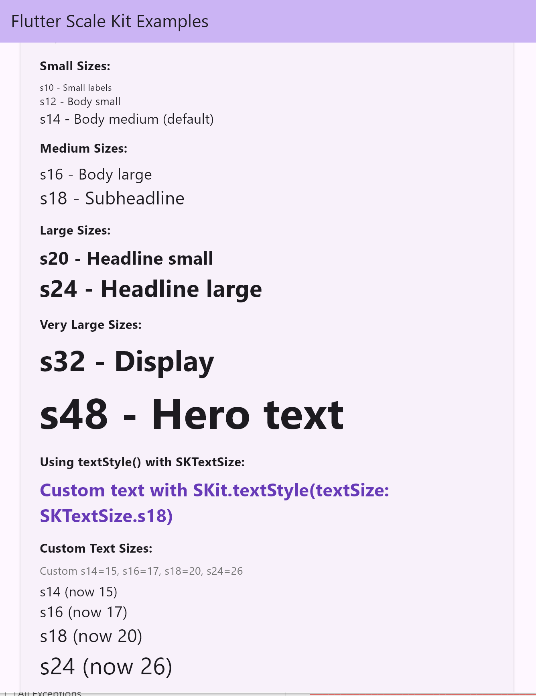
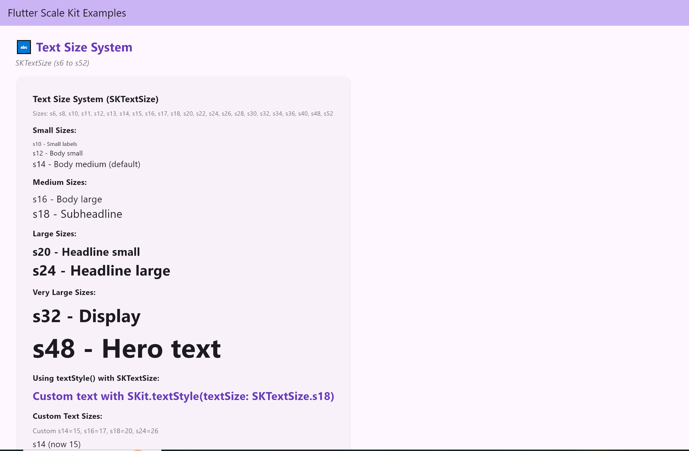
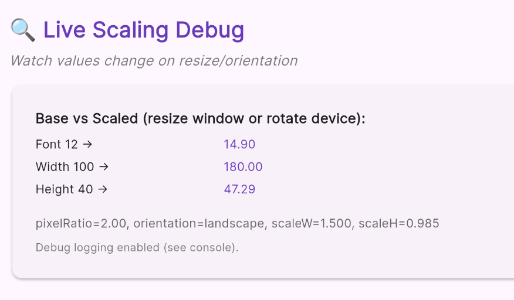

# Flutter Scale Kit

[](https://pub.dev/packages/flutter_scale_kit)
[](https://pub.dev/packages/flutter_scale_kit)
[](https://pub.dev/packages/flutter_scale_kit/score)
[](https://ko-fi.com/fodilfliti)

**Design once at 375×812. Ship to phones, tablets, desktop, and web.**

A high-performance responsive engine with drop-in widgets that scale automatically, smart limits so
nothing explodes on a big monitor, and caching that makes it ~3x faster than a plain map lookup.

<table style="width:100%;">
  <tr>
    <td align="center" width="40%">
      <strong>📱 Mobile</strong><br/>
      
    </td>
    <td align="center" width="60%">
      <strong>📲 Tablet</strong><br/>
      
    </td>
  </tr>
</table>

<strong>🖥️ Desktop</strong>



**One codebase. One design size. Every screen above is the same widget tree.**

### 🎯 [Try the live demo in your browser →](https://fodilfliti.github.io/flutter_scale_kit/)

---

## The difference in one screen

**Before** — the usual responsive code, extension noise on every number:

```dart
Container(
  width: 200.w,
  height: 100.h,
  padding: EdgeInsets.all(16.w),
  margin: EdgeInsets.only(bottom: 12.h),
  decoration: BoxDecoration(
    borderRadius: BorderRadius.circular(12.r),
  ),
  child: Text('Hello', style: TextStyle(fontSize: 16.sp)),
)
```

**After** — write your design numbers, the widget scales them:

```dart
SKContainer(
  width: 200,
  height: 100,
  padding: EdgeInsets.all(16),
  margin: EdgeInsets.only(bottom: 12),
  decoration: BoxDecoration(
    borderRadius: BorderRadius.circular(12), // safely clamped
  ),
  child: SKText('Hello', fontSize: 16),
)
```

Prefer extensions? They still work, and you can mix both in the same file:

```dart
Container(width: 200.w, child: Text('Hi', style: TextStyle(fontSize: 16.sp)))
```

---

## Why developers pick it

| | |
| --- | --- |
| 🧠 **Zero config** | Detects device, orientation, aspect ratio, and density. Picks scale limits automatically. ~95% of projects never tune anything. |
| 🛠️ **Drop-in widgets** | `Container` → `SKContainer`, `Text` → `SKText`. Search-and-replace migration, no refactor. |
| ⚡ **~3x faster scalars** | `.w` / `.h` / `.sp` skip the map cache and use precomputed multipliers. |
| 🧹 **~80% fewer rebuilds** | Listens to size and orientation only. Opening the keyboard does **not** rebuild your app. |
| 🛡️ **No memory leaks** | LRU cache capped at 2000 entries, cleared automatically on resize. |
| 🖥️ **Desktop & web first-class** | Lock desktop to tablet or mobile layouts, override per widget, branch on platform. |
| 🔤 **Language-aware fonts** | Arabic, Japanese, or any group gets its own font automatically across every text style. |
| 🎨 **Optional look companion** | Add [`flutter_scale_theme_kit`](https://pub.dev/packages/flutter_scale_theme_kit) for colors and `ThemeData`. |
| 🤖 **AI agent skill** | Your coding agent uses the package correctly in Cursor, Claude Code, Copilot, and more. |

> If this package helps you, please **[like it on pub.dev](https://pub.dev/packages/flutter_scale_kit)** — it genuinely improves discoverability.

---

## 👀 The whole package in 60 seconds

**Every feature, one example each.** Nothing here needs a click — the links only take you to the
longer treatment further down.

### Sizing

**Scale any number** — [more →](#extension-methods)

```dart
200.w;              // width      100.h;            // height
16.sp;              // font size  12.rSafe;         // radius, gently clamped
0.5.sw;             // 50% of screen width
16.spClamp(14, 20); // scaled, but never outside 14–20 (great for desktop)
```

**Scale whole geometry objects and gaps** — no field-by-field conversion — [more →](#extension-methods)

```dart
EdgeInsets.only(left: 12, right: 12).w;
BoxConstraints(maxWidth: 200, minHeight: 80).r;

Row(children: [avatar, 12.horizontalSpace, title]);  // or HSpace(12.w)
Column(children: [header, 16.verticalSpace, body]);
```

### Widgets

**Drop-in widgets that scale themselves** — pass raw design numbers, [more →](#sk-widgets)

```dart
SKContainer(
  width: 200,
  padding: EdgeInsets.all(16),
  decoration: BoxDecoration(borderRadius: BorderRadius.circular(12)),
  child: SKText('No .w anywhere', fontSize: 16),
);
```

22 replacements in total — `SKCard`, `SKAppBar`, `SKTextField`, `SKElevatedButton`, `SKListTile`,
`SKIcon`, `SKDivider`, the chips, and more. Migration is search-and-replace.

**Images from any source, scaled** — [more →](#sk-widgets)

```dart
SKImage.asset('assets/logo.png', width: 100, height: 100);
SKImage.network(url, width: 200, height: 200, cacheWidth: 400);
```

**Layout helpers for the code you write most** — [more →](#skit-helpers)

```dart
SKit.padding(start: 24, end: 12, child: widget); // RTL-aware, one definition
SKit.roundedContainer(all: 16, color: Colors.white, borderWidth: 1, child: widget);
SKit.vSpace(12);
```

### Design system

**Tokens instead of magic numbers** — [more →](#design-system)

```dart
setPaddingSizes(SizeValues.custom(sm: 8, md: 16, lg: 24));

SKit.paddingSize(all: SKSize.md, child: SKit.text('Hi', textSize: SKTextSize.s16));
```

**Compute a whole screen's tokens in one call** — [more →](#design-system)

```dart
const appDesign = ScaleKitDesignValues(textMd: 14, paddingMd: 16, radiusMd: 12);

final v = appDesign.compute();  // ready EdgeInsets, BorderRadius, TextStyle
SKPadding(padding: v.paddingMd!, child: Text('Hi', style: v.textMd));
```

**Full text control in one call** — every `Text` attribute, all scaled — [more →](#typography)

```dart
SKit.textFull('Hello', fontSize: 18, color: Colors.blue, letterSpacing: 0.5, maxLines: 2);

final style = SKit.textStyleFull(fontSize: 24, fontWeight: FontWeight.bold, height: 1.5);
```

### Look

**Fonts that follow the locale** — set once, applied everywhere — [more →](#typography)

```dart
FontConfig.instance
  ..setDefaultFont(googleFont: GoogleFonts.inter)
  ..setLanguageGroupFont(
    const LanguageGroupFontConfig(
      languageCodes: ['ar', 'fa', 'ur'],
      googleFont: GoogleFonts.almarai,
    ),
  );
```

**A responsive ThemeData** — [more →](#theme-integration)

```dart
MaterialApp(
  theme: ResponsiveThemeData.create(context: context, useMaterial3: true),
);
```

**Or add the look companion** for semantic colors and dark mode — [more →](#look-companion)

```dart
// flutter_scale_theme_kit: colors + ThemeData, Scale Kit keeps the sizing
context.st.primary;  // also .surface, .text, .error, .radius, .card …

appST.light.copyWith(
  textTheme: appST.light.createResponsiveTextTheme(appST.light.textTheme),
);
```

### Responsive layout

**Responsive values — when only a _number_ changes** — [more →](#responsive-layout)

```dart
final columns = SKit.responsiveInt(
  context: context,
  mobile: 2, tablet: 4, desktop: 6,
);

GridView.count(crossAxisCount: columns, children: [...]);
```

**Responsive widgets — when the _layout_ changes** — [more →](#responsive-layout)

```dart
SKResponsive(
  mobile: (_) => const BottomNavShell(),
  tablet: (_) => const NavigationRailShell(),
  desktop: (_) => const SplitViewShell(),
);
```

**Desktop and web on your terms** — [more →](#desktop-web)

```dart
// Globally: make desktop and web reuse your tablet layout
ScaleKitBuilder(lockDesktopPlatforms: true, lockDesktopAsTablet: true, ...);

// Or per widget, without the global lock
SKResponsiveBuilder(desktopAs: DesktopAs.tablet, ...);
```

**Ask the device anything** — [more →](#device-queries)

```dart
if (context.isResponsiveMobile) ...   // scaling / device class (phones stay true in landscape)
if (context.isMobileViewport) ...      // width ≤ breakpoint only — false on landscape phones
if (context.isIOSPlatform) ...         // OS chrome, web and Wasm safe
if (context.isDesktopAtLeastTablet)    // width only, no layout swap
```

**…even without a BuildContext** — [more →](#device-queries)

```dart
class _S extends State<Page> with DeviceMetricsMixin<Page> {
  @override
  Widget build(BuildContext context) => isDesktop ? const Wide() : const Narrow();
}

ScaleManager.instance.screenWidth; // or read the engine directly
```

### Tuning the engine

**Guard rails so nothing explodes on a big screen** — [more →](#scale-limits)

```dart
ScaleKitBuilder(minScale: 0.9, maxScale: 1.2, ...);
```

**Your own breakpoints** — defaults are `600 / 1200 / 1600 / 1920` — [more →](#breakpoints)

```dart
ScaleKitBuilder(
  breakpoints: const ScaleBreakpoints(mobileMaxWidth: 540, tabletMaxWidth: 1100),
  ...
);
```

**Orientation boosts, applied after clamping** — [more →](#orientation-boosts)

```dart
ScaleKitBuilder(
  autoScaleLandscape: true,        // on by default
  mobileLandscapeFontBoost: 1.2,   // readability without inflating containers
  mobileLandscapeSizeBoost: 1.1,
  ...
);
```

Leave all of the above unset and [auto-configuration](#auto-configuration) picks a range per device,
orientation, and aspect ratio — including foldables, ultrawide monitors, and small windows.

**Rebuild sensitivity** — [more →](#performance)

```dart
ScaleKitBuilder(sizeChangeThreshold: 0.01, ...); // rebuild after a 1% window change
```

### Tooling

**Compare against raw Flutter at runtime** — [more →](#enable-disable)

```dart
ScaleKitBuilder(enabledListenable: myToggle, ...); // flip scaling on and off live
```

**Test scaled widgets at any screen size** — [more →](#testing)

```dart
tester.view.physicalSize = const Size(1200, 800);
await tester.pumpWidget(ScaleKitBuilder(designWidth: 375, designHeight: 812, child: ...));
```

**Works inside Device Preview** — [more →](#device-preview)

```dart
ScaleManager.setDevicePreviewPlatformGetter((c) => DevicePreview.platformOf(c));
```

---

## 🤖 Don't want to read all this? Let your AI agent set it up

```bash
npx skills add fodilfliti/flutter_scale_kit
```

Then ask your agent: **"Init Flutter Scale Kit with defaults."**

It installs the dependency, creates `lib/core/scale_kit.dart`, wraps `main.dart`, and from then on
writes Scale Kit code correctly — tokens instead of magic numbers, no double-scaling. Works in
**Cursor, Claude Code, GitHub Copilot, Codex, Windsurf, Gemini CLI**, and any tool that supports the
open [Agent Skills](https://agentskills.io) format.

**→ [Full agent skill details, options, and manual install](#ai-agent-skill)**

---

## 📑 Table of contents

**Get running**

- [Install](#install)
- 📂 [**Starter app**](#starter-app) — copy a real, runnable app: Scale Kit **+** Theme Kit in 4 files
- [Quick start](#quick-start) — runnable `main.dart`, every `ScaleKitBuilder` option, fonts, tokens
- [Choose your approach](#choose-your-approach) — which API for which job
- [⚠️ Gotchas](#gotchas) — read before you ship

**Core APIs**

- [Extension methods](#extension-methods) — `.w` `.h` `.sp` `.r` and constraints
- [Drop-in SK widgets](#sk-widgets) — full list and what each scales
- [SKit helpers](#skit-helpers) — padding, containers, spacing, text
- [Design system tokens](#design-system) — `SKSize`, `ScaleKitDesignValues`
- [Typography & fonts](#typography) — `FontConfig`, language-aware fonts
- [ThemeData integration](#theme-integration)
- [🎨 Look companion (theme kit)](#look-companion)

**Responsive layout**

- [Responsive widgets & values](#responsive-layout) — `SKResponsive`, `responsiveInt`
- [Desktop & web freedom](#desktop-web) — locks, overrides, platform branching
- [Device queries](#device-queries) — context extensions, `DeviceMetricsMixin`
- [Breakpoints & size classes](#breakpoints)

**How it works**

- [Scale limits](#scale-limits) — `minScale` / `maxScale`
- [Orientation boosts](#orientation-boosts)
- [Auto-configuration](#auto-configuration)
- [Performance](#performance)

**Extras**

- [Testing](#testing)
- [Enable/disable at runtime](#enable-disable)
- [Device Preview integration](#device-preview)
- [🤖 AI agent skill](#ai-agent-skill)
- [Migrating from flutter_screenutil](#migration)
- [Advanced guides](#advanced-guides) · [FAQ](#faq) · [Support](#support) · [License](#license)

---

## Install

```yaml
dependencies:
  flutter_scale_kit: ^2.0.1
```

```bash
flutter pub get
```

Optional **look** companion for colors and `ThemeData` (see [below](#look-companion)):

```yaml
dependencies:
  flutter_scale_kit: ^2.0.1
  flutter_scale_theme_kit: ^1.0.1
```

---

## Starter app

[](doc/starter-app.md)

**[→ Open the starter app](doc/starter-app.md)** is a complete first-time setup you can copy file by
file into a new project. Not fragments — an app that runs.

| File | What it holds |
| --- | --- |
| `pubspec.yaml` | Both dependencies |
| `lib/core/design.dart` | Colors and radius tokens (`STTheme`) |
| `lib/core/scale_kit.dart` | Size tokens, defaults, and fonts in one `initScaleKit()` |
| `lib/main.dart` | Both packages wired together, in the order that actually works |
| `lib/pages/home_page.dart` | A real dashboard — responsive grid, themed cards, dark-mode toggle |

It also writes **the same card in all four usage styles** (`design_system`, `drop_in`,
`extensions`, `hybrid`) so you can compare them side by side, and lists the rules that keep sizing
and theming from stepping on each other.

Using Scale Kit on its own? The same files apply — just skip `design.dart` and the `context.st`
colors.

---

## Quick start

**In a hurry?** `npx skills add fodilfliti/flutter_scale_kit`, then tell your agent
_"Init Flutter Scale Kit with defaults."_ — [details below](#ai-agent-skill). Otherwise, read on.

### 1. Wrap your app

A complete, runnable `main.dart`. Copy it, change the design size to your Figma canvas, done.

```dart
import 'package:flutter/material.dart';
import 'package:flutter_scale_kit/flutter_scale_kit.dart';

void main() {
  // Optional: define what 'md' means for your app. Skip it and defaults apply.
  setPaddingSizes(SizeValues.custom(xs: 4, sm: 8, md: 16, lg: 24, xl: 32, xxl: 48));
  setRadiusSizes(SizeValues.custom(xs: 4, sm: 8, md: 12, lg: 16, xl: 20, xxl: 28));
  setSpacingSizes(SizeValues.custom(xs: 4, sm: 8, md: 16, lg: 24, xl: 32, xxl: 48));

  runApp(const MyApp());
}

class MyApp extends StatelessWidget {
  const MyApp({super.key});

  @override
  Widget build(BuildContext context) {
    // ScaleKitBuilder goes ABOVE MaterialApp so every route inherits scaling.
    return ScaleKitBuilder(
      designWidth: 375,
      designHeight: 812,
      designType: DeviceType.mobile,
      child: MaterialApp(
        title: 'My App',
        home: const HomePage(),
      ),
    );
  }
}

class HomePage extends StatelessWidget {
  const HomePage({super.key});

  @override
  Widget build(BuildContext context) {
    return Scaffold(
      appBar: SKAppBar(title: const Text('Scale Kit')),
      body: SKit.paddingSize(
        all: SKSize.md,
        child: Column(
          crossAxisAlignment: CrossAxisAlignment.start,
          children: [
            SKText('Welcome', fontSize: 24, fontWeight: FontWeight.bold),
            SKit.vSpaceSize(SKSize.sm),
            SKText('This text scales on every device.', fontSize: 14),
            SKit.vSpaceSize(SKSize.md),
            SKit.roundedContainerSize(
              all: SKSize.md,
              color: Colors.blue.shade50,
              child: SKit.paddingSize(
                all: SKSize.md,
                child: SKText('A card that scales too.', fontSize: 16),
              ),
            ),
          ],
        ),
      ),
    );
  }
}
```

No `MediaQuery` wiring. No manual breakpoints. No `setState` on resize.

### 2. ScaleKitBuilder options

Only `designWidth`, `designHeight`, and `child` are required. **Everything else is optional** —
each one is auto-detected or has a sensible default.

| Parameter | Default | What it does |
| --- | --- | --- |
| `designWidth` **·** `designHeight` | *required* | Your Figma canvas size, e.g. `375 × 812` |
| `child` | *required* | Your app — put `MaterialApp` here |
| `designType` | `DeviceType.mobile` | Which device your design was drawn for |
| `deviceTypeOverride` | auto | Force a classification instead of detecting it |
| `minScale` **·** `maxScale` | auto | Clamp range, so nothing explodes on a big screen — [more →](#scale-limits) |
| `autoScale` | `true` | Master switch for automatic limits |
| `autoScaleLandscape` | `true` | Apply landscape boosts on rotate |
| `autoScalePortrait` | `false` | Apply portrait boosts too |
| `breakpoints` | `600 / 1200 / 1600 / 1920` | Your own device thresholds — [more →](#breakpoints) |
| `lockDesktopPlatforms` | `false` | Pin desktop and web to a chosen breakpoint |
| `lockDesktopAsTablet` | `false` | …specifically the tablet branch |
| `lockDesktopAsMobile` | `false` | …specifically the mobile branch |
| `enabled` | `true` | Turn scaling off to compare against raw Flutter |
| `enabledListenable` | `null` | `ValueListenable<bool>` for a runtime toggle — [more →](#enable-disable) |
| `sizeChangeThreshold` | `0.05` mobile, `0` desktop | How much the window must change before a rebuild |
| `{mobile,tablet,desktop}{Landscape,Portrait}{Font,Size}Boost` | auto | 12 fine-grained multipliers — [more →](#orientation-boosts) |

A tuned example — strict scale range, tablet layout reused on desktop, custom breakpoints:

```dart
ScaleKitBuilder(
  designWidth: 375,
  designHeight: 812,
  designType: DeviceType.mobile,

  // Keep the UI close to spec instead of the auto range
  minScale: 0.9,
  maxScale: 1.2,

  // Desktop and web borrow the tablet layout
  lockDesktopPlatforms: true,
  lockDesktopAsTablet: true,

  // Your own thresholds
  breakpoints: const ScaleBreakpoints(
    mobileMaxWidth: 540,
    tabletMaxWidth: 1100,
    desktopMaxWidth: 1650,
    largeDesktopMaxWidth: 2200,
  ),

  // Bump readability in landscape without inflating containers
  mobileLandscapeFontBoost: 1.2,
  mobileLandscapeSizeBoost: 1.1,

  child: const MyApp(),
);
```

### 3. Optional setup

All four steps below are optional — the package works without any of them. Put them in `main()`
before `runApp`, or in a single `lib/core/scale_kit.dart` file.

**a. Design tokens** — decide what `sm` / `md` / `lg` mean once:

```dart
  setPaddingSizes(SizeValues.custom(xs: 4, sm: 8, md: 16, lg: 24, xl: 32, xxl: 48));
  setMarginSizes(SizeValues.custom(xs: 2, sm: 4, md: 8, lg: 12, xl: 16, xxl: 24));
  setRadiusSizes(SizeValues.custom(xs: 2, sm: 4, md: 8, lg: 12, xl: 16, xxl: 24));
setSpacingSizes(SizeValues.custom(xs: 4, sm: 8, md: 12, lg: 16, xl: 20, xxl: 24));
setTextSizes(TextSizeValues.material3());
```

Defaults if you skip it: `xs: 2, sm: 4, md: 8, lg: 12, xl: 16, xxl: 24`.

**b. Default values** — so shorthand helpers need no arguments:

```dart
  setDefaultPadding(16);
  setDefaultMargin(8);
setDefaultRadius(12);
setDefaultSpacing(8);
setDefaultTextSize(14);
```

Now `SKit.pad()`, `SKit.margin()`, `SKit.rounded()`, `SKit.h()`, and `SKit.v()` work bare.

**c. Fonts** — set once, applied to **every** scaled text style automatically. No wiring at the
call site, and the right font is picked from the active locale:

```dart
import 'package:google_fonts/google_fonts.dart';

  FontConfig.instance
    ..setDefaultFont(googleFont: GoogleFonts.inter)
    ..setLanguageFont(
      const LanguageFontConfig(
        languageCode: 'ja',
        googleFont: GoogleFonts.notoSansJp,
      ),
    )
    ..setLanguageGroupFont(
      const LanguageGroupFontConfig(
        languageCodes: ['ar', 'fa', 'ur'],
        googleFont: GoogleFonts.almarai,
      ),
    );
```

Extensions, `SKText`, `SKit.text*`, and responsive themes all pick this up. A custom family works
the same way: `setDefaultFont(customFontFamily: 'Cairo')`. `google_fonts` is **not** a dependency
of this package — you pass the builders in yourself. [More on fonts](#typography)

**d. Screen tokens** — for screens with many values, define them once as a `const` and compute the
whole set in one call instead of scaling each number separately:

```dart
// lib/core/design.dart — const, so it costs nothing to hold
const appDesign = ScaleKitDesignValues(
  textSm: 12, textMd: 14, textLg: 16, textXl: 24,
  paddingSm: 8, paddingMd: 16, paddingLg: 24,
  spacingSm: 8, spacingMd: 16, spacingLg: 24,
  radiusSm: 6, radiusMd: 12, radiusLg: 16,
);
```

```dart
  @override
  Widget build(BuildContext context) {
  final v = appDesign.compute(); // one calculation for the whole screen

  return SKPadding(
    padding: v.paddingMd!,
    child: SKContainer(
      decoration: BoxDecoration(
        color: Colors.white,
        borderRadius: v.borderRadiusMd,
      ),
      child: Text('Already scaled', style: v.textMd),
    ),
  );
}
```

`compute()` hands back ready-made `EdgeInsets`, `BorderRadius`, and `TextStyle` objects.
[More on tokens](#design-system)

---

## Choose your approach

Four ways to use Scale Kit. **Mix them freely** — pick per situation, not per project.

| Your situation | Use this | Example |
| --- | --- | --- |
| **New app, want consistency** | Tokens + `SK*` widgets | `SKit.paddingSize(all: SKSize.md, child: SKText('Hi', fontSize: 16))` |
| **Migrating an app fast** | `SK*` drop-ins, raw numbers | `SKContainer(width: 120, child: SKText('Hi', fontSize: 16))` |
| **Coming from screenutil** | Extensions on Flutter widgets | `Container(width: 120.w, child: Text('Hi', style: TextStyle(fontSize: 16.sp)))` |
| **One odd Figma number (73px)** | Extension, inline | `SizedBox(width: 73.w)` |
| **Value gets huge on desktop** | Constraint extension | `200.wMax(360)`, `16.spClamp(14, 20)` |
| **Grid columns / item counts** | Responsive value | `SKit.responsiveInt(context: context, mobile: 2, tablet: 4, desktop: 6)` |
| **Layout _structure_ changes** | Responsive builder | `SKResponsiveBuilder(mobile: ..., desktop: ...)` |

### What NOT to reach for

| Don't | Because |
| --- | --- |
| `SKResponsive` just to change padding or font size | Tokens and `SK*` already scale — you are adding a rebuild for nothing |
| `.w` on every single number | That is the screenutil habit; `SK*` widgets remove it |
| A second `ScaleKitBuilder` deeper in the tree | One at the root is enough; nesting creates conflicting scopes |
| Full `MediaQuery` subscriptions for sizing | The builder already listens to size and orientation efficiently |

### Recommended stack for a new app

1. `ScaleKitBuilder` + token setup in one file (`lib/core/scale_kit.dart`)
2. `SKSize` tokens for padding, margin, radius, spacing
3. `SK*` drop-in widgets with raw design numbers
4. `.w` / `.sp` / `.rSafe` only as escape hatches

> 📂 **See all four styles side by side:** the [starter app](doc/starter-app.md) writes the same
> card as `design_system`, `drop_in`, `extensions`, and `hybrid`, so you can compare and pick one.
> Those are also the style names the [AI agent skill](#ai-agent-skill) understands.

---

## Gotchas

Four rules. They cover almost every issue people hit.

### 1. Never double-scale

`SK*` widgets scale internally. Passing an already-scaled value scales it twice.

```dart
SKContainer(width: 120)     // ✅ correct
SKContainer(width: 120.w)   // ❌ scaled twice

SKText('Hi', fontSize: 16)     // ✅ correct
SKText('Hi', fontSize: 16.sp)  // ❌ scaled twice
```

### 2. Pick the right radius

| Extension | Use for |
| --- | --- |
| `.rSafe` | **Cards, sheets, containers** — the safe default |
| `.r` | Pills, circular avatars, fully rounded chips |
| `.rFixed` | Hairlines that must never change |

`SK*` widgets already apply `rSafe` to `borderRadius` for you.

### 3. `ScaleKitBuilder` goes above `MaterialApp`

```dart
ScaleKitBuilder(child: MaterialApp(...))  // ✅
MaterialApp(home: ScaleKitBuilder(...))   // ❌ routes above it won't scale
```

### 4. Theme needs a context under the builder

`ResponsiveThemeData.create` reads the active scale, so it needs a `BuildContext` **below**
`ScaleKitBuilder`. Wrap it in a `Builder`:

```dart
ScaleKitBuilder(
  designWidth: 375,
  designHeight: 812,
  child: Builder(
    builder: (context) => MaterialApp(
      theme: ResponsiveThemeData.create(context: context, useMaterial3: true),
      home: const HomePage(),
    ),
  ),
)
```

---

## Extension methods

Familiar if you come from `flutter_screenutil`. Works on any `num`.

```dart
200.w;      // scaled width
100.h;      // scaled height
16.sp;      // scaled font size
16.spf;     // font size × system text scale factor
12.r;       // fully scaled radius
12.rSafe;   // radius with gentle clamping (use for cards)
12.rFixed;  // never scaled
0.5.sw;     // 50% of screen width
0.3.sh;     // 30% of screen height
```

### Constraints (min / max / clamp)

Every extension has `Min`, `Max`, and `Clamp` forms. Essential for desktop, where an unclamped
value can get enormous.

```dart
200.wMax(300);          // scaled width, never above 300
100.hClamp(50, 150);    // scaled height, kept in 50–150
16.spClamp(12, 24);     // font size, kept in 12–24
12.rSafeClamp(8, 20);   // safe radius, kept in 8–20
0.5.swClamp(200, 400);  // 50% of width, kept in 200–400
```

Full set: `.wMin/.wMax/.wClamp`, `.hMin/.hMax/.hClamp`, `.spMin/.spMax/.spClamp`,
`.rMin/.rMax/.rClamp`, `.rSafeClamp`, `.swMin/.swMax/.swClamp`, `.shMin/.shMax/.shClamp`.

### On geometry objects

Skip converting each field by hand:

```dart
EdgeInsets.only(left: 12, right: 12).w;          // both sides scaled
EdgeInsetsDirectional.only(start: 16).h;         // RTL-aware
BoxConstraints(maxWidth: 200, minHeight: 80).r;
Radius.circular(24).w;
BorderRadius.circular(16).h;
```

### Gap extensions

```dart
Row(
  children: [
    const Avatar(),
    12.horizontalSpace,        // → HSpace(12.w)
    const Expanded(child: Title()),
  ],
);

Column(
  children: [
    const Header(),
    16.verticalSpace,          // → VSpace(16.h)
    const Body(),
  ],
);
```

> ⚡ **All of this is cached.** Base extensions and constraint variants alike. A value is computed
> once per unique combination and reused across rebuilds. The cache clears on resize and rotation.

---

## SK widgets

Replacements for Flutter widgets that scale their own properties. **Pass raw design numbers.**

Migration is a search-and-replace: `Container` → `SKContainer`, `Text` → `SKText`,
`Padding` → `SKPadding`, `TextField` → `SKTextField`, `ElevatedButton` → `SKElevatedButton`.
Your code keeps working, now with scaling.

```dart
SKPadding(
  padding: EdgeInsets.all(16),
  child: SKMargin(
    margin: EdgeInsets.only(bottom: 12),
    child: SKContainer(
      width: 200,
      height: 100,
      padding: EdgeInsets.symmetric(horizontal: 12, vertical: 10),
      decoration: BoxDecoration(
        color: Colors.blue.shade50,
        borderRadius: BorderRadius.circular(12), // uses rSafe automatically
      ),
      child: SKText('Everything here scales', fontSize: 14, fontWeight: FontWeight.bold),
    ),
  ),
)
```

### Complete list and what each one scales

| Widget | Scaled properties |
| --- | --- |
| `SKContainer` | `width`, `height`, `padding`, `margin`, `borderRadius` (via `rSafe`), `boxShadow`, border width, `constraints` |
| `SKPadding` | `EdgeInsets` and `EdgeInsetsDirectional` values |
| `SKMargin` | `EdgeInsets` and `EdgeInsetsDirectional` values |
| `SKText` | `fontSize`, plus `FontConfig` font when configured |
| `SKIcon` | `size` |
| `SKCard` | `margin`, `elevation`, `shape.borderRadius` |
| `SKDivider` | `thickness`, `indent`, `endIndent`, `height` |
| `SKAppBar` | `toolbarHeight`, `elevation`, `titleSpacing`, `leadingWidth` |
| `SKListTile` | `contentPadding`, `minLeadingWidth`, `minVerticalPadding` |
| `SKSwitch` | `splashRadius` |
| `SKSwitchListTile` | `contentPadding`, `splashRadius` |
| `SKTextField` | `fontSize`, `InputDecoration` padding, `borderRadius`, `cursorWidth`, `cursorHeight` |
| `SKTextFormField` | Same as `SKTextField`, plus form validation |
| `SKElevatedButton` | `padding`, `minimumSize`, `fixedSize`, `borderRadius`, `elevation` |
| `SKTextButton` | `padding`, `minimumSize`, `fixedSize`, `borderRadius` |
| `SKOutlinedButton` | `padding`, `minimumSize`, `fixedSize`, `borderRadius` |
| `SKIconButton` | `iconSize`, `padding`, `constraints` |
| `SKActionChip` | `padding`, `labelPadding`, `avatarPadding`, `borderRadius`, `elevation`, `deleteIconSize` |
| `SKFilterChip` | Same as `SKActionChip` |
| `SKChoiceChip` | `padding`, `labelPadding`, `avatarPadding`, `borderRadius`, `elevation` |
| `SKInputChip` | Same as `SKActionChip` |
| `SKImage` | `width`, `height` |

### More examples

```dart
SKIcon(Icons.home, size: 24);

SKCard(
  margin: EdgeInsets.all(16),
  elevation: 4,
  shape: RoundedRectangleBorder(borderRadius: BorderRadius.circular(12)),
  child: Text('Card content'),
);

SKDivider(thickness: 1, indent: 16, endIndent: 16);

SKListTile(
  leading: SKIcon(Icons.person, size: 24),
  title: SKText('Title', fontSize: 16),
  contentPadding: EdgeInsets.all(16),
  minLeadingWidth: 40,
);
```

### SKImage — four sources

```dart
SKImage.asset('assets/images/logo.png', width: 100, height: 100, fit: BoxFit.cover);

SKImage.network(
  'https://example.com/image.jpg',
  width: 200,
  height: 200,
  headers: {'Authorization': 'Bearer token'},
  cacheWidth: 400,   // memory optimization
  cacheHeight: 400,
);

SKImage.file(File('/path/to/image.png'), width: 150, height: 150);
SKImage.memory(imageBytes, width: 120, height: 120);
```

### Const spacing widgets

| Widget | Purpose |
| --- | --- |
| `SKSizedBox({width, height})` | `SizedBox` wrapper usable in const contexts |
| `HSpace(double width)` | Horizontal gap |
| `VSpace(double height)` | Vertical gap |
| `SSpace(double size)` | Square gap on both axes |

> 💡 **Mixing is safe.** Every SK widget inspects incoming numbers and only scales unmarked ones, so
> `width: 120`, `width: 120.wMax(240)`, and `borderRadius: BorderRadius.circular(24.r)` all work on
> the same widget. That said, the habit to build is: **raw numbers inside `SK*` widgets.**

---

## SKit helpers

Shortcuts for the layout code you write most often.

### Padding and margin

```dart
SKit.padding(all: 16, child: widget);
SKit.padding(horizontal: 24, vertical: 12, child: widget);
SKit.paddingSize(all: SKSize.md, child: widget);
SKit.paddingSize(horizontal: SKSize.lg, vertical: SKSize.sm, child: widget);

SKit.margin(12, child: widget);
SKit.marginSize(all: SKSize.md, child: widget);

// Raw EdgeInsets for your own widgets
final insets = SKit.paddingEdgeInsets(all: 16);
final marginInsets = SKit.marginEdgeInsetsSize(all: SKSize.md);
```

`start` and `end` resolve against `Directionality`, so **one definition serves both LTR and RTL**:

```dart
SKit.padding(start: 24, end: 12, vertical: 16, child: content);
```

### Rounded containers

```dart
SKit.roundedContainer(
  all: 16,
  color: Colors.white,
  padding: EdgeInsets.symmetric(horizontal: 20.w, vertical: 16.h),
  borderColor: Colors.black12,
  borderWidth: 1,
  radiusMode: SKRadiusMode.safe, // default
  child: Column(
    crossAxisAlignment: CrossAxisAlignment.start,
    children: [
      SKit.text('Dashboard', textSize: SKTextSize.s20, fontWeight: FontWeight.w600),
      SizedBox(height: 12.h),
      SKit.text('All metrics auto-scale.', textSize: SKTextSize.s16),
    ],
  ),
);
```

Border options:

| Parameter | Purpose |
| --- | --- |
| `borderColor` | Color for all sides when individual sides are unset |
| `borderWidth` | Width for all sides (scaled) |
| `borderTop` / `borderBottom` / `borderLeft` / `borderRight` | Enable a specific side |
| `borderTopColor` / `borderBottomColor` / `borderLeftColor` / `borderRightColor` | Per-side colors |
| `borderTopWidth` / `borderBottomWidth` / `borderLeftWidth` / `borderRightWidth` | Per-side widths (scaled) |

```dart
// Border on specific sides only
SKit.roundedContainer(
  all: 12,
  color: Colors.green.shade50,
  borderTop: true,
  borderBottom: true,
  borderColor: Colors.green,
  borderWidth: 2,
  child: Text('Content'),
);
```

> When individual sides use different colors, Flutter's `BoxDecoration` cannot combine a
> non-uniform border with `borderRadius`. Scale Kit omits the radius in that case to avoid a
> render error.

### Spacing

```dart
SKit.hSpace(8);              // horizontal gap
SKit.vSpace(8);              // vertical gap
SKit.sSpace(8);              // square gap
SKit.hSpaceSize(SKSize.md);  // token-based
SKit.vSpaceSize(SKSize.sm);
```

### Shorthand (uses your `setDefault*` values)

```dart
SKit.pad()      // padding 16
SKit.margin()   // margin 8
SKit.rounded()  // safe radius 12
SKit.h()        // horizontal gap 8
SKit.v()        // vertical gap 8
```

`SKit.rounded` takes positional arguments: `rounded([size, child, color, borderColor, borderWidth, radiusMode])`.

---

## Design system

Define your scale once, then use names instead of numbers everywhere.

### Size enums

```dart
SKit.paddingSize(all: SKSize.md, child: widget);
SKit.marginSize(all: SKSize.md, child: widget);
SKit.roundedContainerSize(all: SKSize.lg, color: Colors.blue);
SKit.hSpaceSize(SKSize.md);
```

`SKSize`: `xs`, `sm`, `md`, `lg`, `xl`, `xxl`. Text uses `SKTextSize`: `s6` through `s52`.

### Preset scales

```dart
setPaddingSizes(SizeValues.material3()); // xs 4, sm 8, md 12, lg 16, xl 24, xxl 32
setPaddingSizes(SizeValues.tailwind());
setTextSizes(TextSizeValues.material3());
```

### ScaleKitDesignValues — compute once per screen

Introduced in [Quick start step 3d](#quick-start): define a `const` token set, call `compute()`
once per build, and use the results directly. Beyond `text*`, `padding*`, `spacing*`, and
`radius*`, the class also carries `margin*`, `paddingHorizontal` / `paddingVertical`,
`marginHorizontal` / `marginVertical`, `width*`, `height*`, and `radiusAll`.

```dart
const cardDesign = ScaleKitDesignValues(
  textMd: 14,
  textLg: 18,
  paddingMd: 16,
  marginSm: 8,
  radiusMd: 12,
  widthMd: 280,
  heightMd: 160,
);

final v = cardDesign.compute();

SKMargin(
  margin: v.marginSm!,
  child: SKContainer(
    width: v.widthMd,     // already scaled
    height: v.heightMd,
    padding: v.paddingMd,
    decoration: BoxDecoration(
      color: Colors.white,
      borderRadius: v.borderRadiusMd,
    ),
    child: Text('Card title', style: v.textLg),
  ),
);
```

`compute()` returns a `ScaleKitDesignValuesSet` where `padding*` and `margin*` are
`EdgeInsetsGeometry`, `borderRadius*` are `BorderRadius`, `text*` are `TextStyle`, and
`width*` / `height*` / `spacing*` / `radius*` are plain scaled doubles. **Why:** one calculation
per screen, centralized tokens, no magic numbers.

Values from `compute()` are already marked as scaled, so passing them into `SK*` widgets is safe —
they get resolved, not scaled twice.

> `SKitTheme` / `SKitThemeValues` are the deprecated old names for `ScaleKitDesignValues` /
> `ScaleKitDesignValuesSet`. Existing code still compiles; use the new names in new code.

---

## Typography

### Text widgets

```dart
// Drop-in
SKText('Hello', fontSize: 16, fontWeight: FontWeight.w600);

// Token-based
SKit.text('Hello', textSize: SKTextSize.s16, fontWeight: FontWeight.w600);

// Every Flutter Text attribute, all scaled
SKit.textFull(
  'Hello World',
  fontSize: 18,
  fontWeight: FontWeight.w600,
  color: Colors.blue,
  letterSpacing: 0.5,
  decoration: TextDecoration.underline,
  shadows: [Shadow(color: Colors.black26, offset: Offset(1, 1))],
  textAlign: TextAlign.center,
  maxLines: 2,
  overflow: TextOverflow.ellipsis,
);

// Reusable style object
final headerStyle = SKit.textStyleFull(
  fontSize: 24,
  fontWeight: FontWeight.bold,
  color: Colors.white,
  height: 1.5,
);
```

`textFull` and `textStyleFull` cover style (`fontSize`, `fontWeight`, `fontStyle`, `color`,
`backgroundColor`, `fontFamily`), spacing (`letterSpacing`, `wordSpacing`, `height`), decoration,
layout (`textAlign`, `maxLines`, `overflow`, `softWrap`), and effects (`shadows`, `foreground`).

### Language-aware fonts

`FontConfig` is optional and set up once in `main()` — see
[Quick start step 3c](#quick-start) for the full example. This section covers how it resolves.

**Resolution order** for a given locale:

1. An exact `setLanguageFont` match on `languageCode` (`'ja'` → Noto Sans JP)
2. A `setLanguageGroupFont` whose `languageCodes` contain that code (`'ar'`, `'fa'`, `'ur'` → Almarai)
3. The `setDefaultFont` font
4. Flutter's default font, if nothing is configured

The result reaches **every** scaled text path automatically — no wiring at the call site:

```dart
Text('Hello', style: TextStyle(fontSize: 16.sp)); // font already applied
SKText('Hello', fontSize: 16);                    // same
SKit.text('Hello', textSize: SKTextSize.s16);     // same
```

Each setter accepts either a Google Font builder or a bundled family, so mixing is fine:

```dart
FontConfig.instance
  ..setDefaultFont(customFontFamily: 'Cairo')
  ..setLanguageFont(
    const LanguageFontConfig(languageCode: 'en', googleFont: GoogleFonts.inter),
  );
```

> `google_fonts` is **not** a dependency of this package. You pass `GoogleFonts.*` builders in
> yourself, so apps that don't need it carry no extra weight.

---

## Theme integration

Use `ResponsiveThemeData.create` when you are **not** using `flutter_scale_theme_kit`. The context
must sit under `ScaleKitBuilder`, so wrap it in a `Builder`:

```dart
ScaleKitBuilder(
  designWidth: 375,
  designHeight: 812,
  child: Builder(
    builder: (context) {
      return MaterialApp(
    theme: ResponsiveThemeData.create(
      context: context,
      colorScheme: ColorScheme.fromSeed(seedColor: Colors.deepPurple),
      useMaterial3: true,
    ),
        home: const HomePage(),
      );
    },
  ),
);
```

---

## Look companion

Scale Kit is **size**. For semantic colors, light/dark, and Material look, add the sibling package
**[`flutter_scale_theme_kit`](https://pub.dev/packages/flutter_scale_theme_kit)**.

Neither package depends on the other at runtime — use either alone, or both together.

If you add Theme Kit, use it for all color (`STTheme`, `context.st`) and keep Scale Kit for size.
Merge them by scaling **only the text theme**:

```dart
import 'package:flutter_scale_kit/flutter_scale_kit.dart';
import 'package:flutter_scale_theme_kit/flutter_scale_theme_kit.dart';
import 'core/design.dart'; // final appST = STTheme(colors: ..., radius: ...);

ScaleKitBuilder(
  designWidth: 375,
  designHeight: 812,
  child: Builder(
    builder: (context) {
      return STThemeModeScope(
        builder: (context, mode) {
          return MaterialApp(
            theme: appST.light.copyWith(
              textTheme: appST.light.createResponsiveTextTheme(
                appST.light.textTheme,
              ),
            ),
            darkTheme: appST.dark.copyWith(
              textTheme: appST.dark.createResponsiveTextTheme(
                appST.dark.textTheme,
              ),
            ),
            themeMode: mode.mode,
            home: const HomePage(),
          );
        },
      );
    },
  ),
);
```

> ⚠️ **Do not** pass `ResponsiveThemeData.create(...)` as `theme:` when using Theme Kit — it
> replaces the whole theme and drops Theme Kit's card, button, and input styling.

Keep radius aligned across both: `setRadiusSizes(SizeValues.custom(md: 12))` and `STRadius(md: 12)`.

Using them in a widget — **colors from `context.st`, sizes from Scale Kit**:

```dart
SKContainer(
  padding: EdgeInsets.all(16),                 // size  → raw number, auto-scaled
  decoration: BoxDecoration(
    color: context.st.surface,                 // look  → Theme Kit
    borderRadius: BorderRadius.circular(12),   // size  → clamped via rSafe
    border: Border.all(color: context.st.border),
  ),
  child: SKText('Revenue', fontSize: 16, color: context.st.text),
);
```

Light/dark toggling belongs to Theme Kit too:

```dart
IconButton(
  icon: Icon(context.stMode.isDark(context) ? Icons.light_mode : Icons.dark_mode),
  onPressed: () => context.stMode.toggle(),
);
```

> 📂 **Copy a working setup:** the **[starter app](doc/starter-app.md)** walks through both packages
> in four files — `pubspec.yaml`, colors, Scale Kit config, `main.dart`, and a real dashboard
> screen — plus the rules that keep the two from fighting.

Theme Kit skill: `npx skills add fodilfliti/flutter_scale_theme_kit`

---

## Responsive layout

### Responsive values — for numbers

Grid columns, item counts, spacing. **Prefer this over a responsive builder** when only a number
changes.

```dart
final columns = SKit.responsiveInt(
  context: context,
  mobile: 2,          // required base
  tablet: 4,          // optional
  desktop: 6,         // optional
  mobileLandscape: 3, // optional
);

GridView.count(crossAxisCount: columns, children: [...]);
```

```dart
final spacing = SKit.responsiveDouble(
  context: context,
  mobile: 8.0,
  tablet: 16.0,
  desktop: 24.0,
);
```

Always pass `context` so values refresh on resize and rotation.

### SKResponsive — different widget per device

Use when the layout **structure** changes: a navigation rail instead of a bottom bar, a split view
instead of a list.

```dart
SKResponsive(
  mobile: (_) => const BottomNavShell(),
  mobileLandscape: (_) => const NavigationRailShell(),
  tablet: (_) => const NavigationRailShell(),
  tabletLandscape: (_) => const SplitViewShell(),
  desktop: (_) => const SplitViewShell(),
);
```

### SKResponsiveBuilder — two styles

**Style 1** — one builder that receives device and orientation:

```dart
SKResponsiveBuilder(
  builder: (context, device, orientation) {
    if (device == DeviceType.mobile && orientation == Orientation.landscape) {
      return const MobileLandscapeView();
    }
    if (device == DeviceType.tablet) return const TabletView();
    return const DesktopView();
  },
);
```

**Style 2** — separate builders, like `SKResponsive`:

```dart
SKResponsiveBuilder(
  mobile: (_) => const MobileView(),
  tablet: (_) => const TabletView(),
  desktop: (_) => const DesktopView(),
);
```

If you supply both, device-specific builders win over the general `builder`.

### Fallback rules

Shared by every responsive widget and value helper:

- **Device:** desktop → tablet → mobile; tablet → mobile
- **Orientation:** landscape → portrait of the same device
- `mobileLandscape` → falls back to `mobile`
- `tabletLandscape` → falls back to `tablet` → `mobileLandscape` → `mobile`

---

## Desktop web

Desktop and web are harder than phones: users resize windows constantly, ultrawide monitors sit
next to tiny browser panes, and some screens read better borrowing a tablet or even a mobile
layout. Scale Kit gives you switches instead of one fixed breakpoint.

### Global locks

```dart
ScaleKitBuilder(
  designWidth: 375,
  designHeight: 812,
  lockDesktopPlatforms: true,  // pin desktop/web to a chosen breakpoint
  lockDesktopAsTablet: true,   // ...specifically the tablet branch
  // lockDesktopAsMobile: true,
  child: MaterialApp(home: HomePage()),
);
```

Locks still respect live window width. `lockDesktopAsMobile` only routes to the mobile branch when
the window is actually below the mobile breakpoint — a wide window keeps the desktop builder.

### Per-widget overrides

Every responsive widget and value helper accepts the same flags, so one route can deviate:

```dart
SKResponsiveBuilder(
  desktop: (_) => DesktopDashboard(),
  tablet: (_) => TabletDashboard(),
  mobile: (_) => MobileDashboard(),
  lockDesktopAsTablet: true,              // reuse tablet on smaller windows
  deviceTypeOverride: DeviceType.desktop, // or force one classification
  desktopAs: DesktopAs.tablet,            // reuse tablet values without the global lock
);
```

### Platform branching inside a breakpoint

Two devices can share a width and still deserve different chrome:

```dart
Widget buildToolbar(BuildContext context) {
  if (context.isAndroidPlatform) return const AndroidToolbar();
  if (context.isIOSPlatform) return const IOSToolbar();
  if (context.isDesktopPlatform) return const DesktopToolbar();
  if (context.isWebPlatform) return const WebToolbar();
  return const UniversalToolbar();
}
```

### Width-only decisions

Tweak spacing for ultrawide monitors **without** swapping the widget tree:

```dart
if (context.isDesktopAtLeastTablet) {
  // widen the content column, keep the same layout
}
```

Available: `context.isDesktopSize`, `isDesktopAtLeastTablet`, `isDesktopAtLeastDesktop`,
`isDesktopMobileSize`, `isDesktopTabletSize`, `isDesktopDesktopOrLarger`.

### CSS-like behavior

On Android and iOS, devices classify as mobile or tablet by width only — desktop logic does not
apply. On desktop (width ≥ 1200 by default), desktop values apply, and `desktopAs` lets you reuse
tablet or mobile values to mimic CSS breakpoints.

```dart
// 2 / 4 / 8 columns, but desktop reuses the tablet count
final cols = SKit.responsiveInt(
  context: context,
  mobile: 2,
  tablet: 4,
  desktop: 8,
  desktopAs: DesktopAs.tablet,
);
```

---

## Device queries

Three axes — do not mix them: **responsive device class** (scaling, `SKResponsiveBuilder`),
**platform** (Android/iOS/desktop OS), **viewport width** (CSS-like breakpoints). A phone in
landscape often has `context.isMobileViewport == false` while `context.isResponsiveMobile` stays
`true`. Full guide: [skills/flutter-scale-kit/device-classification.md](skills/flutter-scale-kit/device-classification.md).

### Context extensions

```dart
// Responsive device class — scaling, SKResponsiveBuilder (phones stay mobile in landscape)
context.isResponsiveMobile   context.isResponsiveTablet   context.isResponsiveDesktop
context.isTypeOfMobile()     // same; optional source: responsive | platform | size

// OS / hardware — orientation-independent
context.isMobilePlatform   context.isAndroidPlatform   context.isIOSPlatform
context.isDesktopPlatform  context.isWebPlatform

// Viewport width only — changes when rotated (alias: isMobile == isMobileViewport)
context.isMobileViewport   context.isTabletViewport   context.isDesktopViewport
context.screenSizeClass    context.isMobileSize   context.isTabletSize   context.isDesktopSize
```

`designType` on `ScaleKitBuilder` is **not applied** yet. Use `deviceTypeOverride` to force mobile/tablet/desktop detection.

Scaling helpers are on `context` too:

```dart
Container(
  padding: context.scalePadding(start: 24, end: 12, vertical: 16),
  margin: context.scaleMargin(all: 8),
  decoration: BoxDecoration(
    borderRadius: context.scaleBorderRadius(all: 12),
  ),
  child: const Text('Content'),
);
```

Also: `context.scaleWidth(200)`, `context.scaleHeight(100)`, `context.scaleFontSize(16)`,
`context.scaleSize(12)`.

### Choosing the classification source

```dart
context.isTypeOfMobile(source: DeviceClassificationSource.responsive); // default
context.isTypeOfTablet(source: DeviceClassificationSource.platform);
context.isTypeOfDesktop(source: DeviceClassificationSource.size, includeWeb: true);
```

### DeviceMetricsMixin — no BuildContext needed

```dart
class DashboardState extends State<Dashboard>
    with DeviceMetricsMixin<Dashboard> {
  @override
  Widget build(BuildContext context) {
    // Prefer context under ScaleKitBuilder for responsive device class:
    if (context.isResponsiveMobile) return const MobileDashboard();
    if (context.isResponsiveTablet) return const TabletDashboard();
    return const DesktopDashboard();
  }

  @override
  void onDeviceMetricsChanged(Size previous, Size current) {
    debugPrint('Metrics changed: $current');
  }
}
```

Exposes `logicalScreenSize`, `devicePixelRatio`, width-based `isMobile` / `isTablet` / `isDesktop`
(viewport width — see [device-classification](skills/flutter-scale-kit/device-classification.md)),
`isMobilePlatform`, `isDesktopPlatform`, `isWeb`, `isAndroidPlatform`, `isIOSPlatform`, and the
`onDeviceMetricsChanged` hook. Values stay in sync with `WidgetsBinding`.

### ScaleManager — direct access

```dart
final scale = ScaleManager.instance;

scale.getWidth(200);      scale.getHeight(100);
scale.getFontSize(16);    scale.getRadius(12);
scale.screenWidth;        scale.screenHeight;
scale.orientation;        scale.deviceType;
scale.statusBarHeight;    scale.bottomBarHeight;
scale.safeAreaHeight;     scale.textScaleFactor;
scale.platformCategory;   scale.screenSizeClass;
```

---

## Breakpoints

Defaults are `600 / 1200 / 1600 / 1920`. Override them to match your design system:

```dart
const customBreakpoints = ScaleBreakpoints(
  mobileMaxWidth: 540,
  tabletMaxWidth: 1100,
  desktopMaxWidth: 1650,
  largeDesktopMaxWidth: 2200,
);

ScaleKitBuilder(
  breakpoints: customBreakpoints,
  designWidth: 375,
  designHeight: 812,
  child: MaterialApp(home: HomePage()),
);
```

`DeviceSizeClass` then reports against your thresholds: `smallMobile`, `mobile`, `largeMobile`,
`tablet`, `largeTablet`, `desktop`, `largeDesktop`, `extraLargeDesktop`.

---

## Scale limits

`minScale` and `maxScale` are guard rails that stop a layout from exploding on a big screen. **You
can leave them unset** — Scale Kit picks a range per device type and orientation.

### Why they matter

Design `375×812` (iPhone 13 mini) shown on an iPad Pro portrait (`1024×1366`):

```
Without limits:
  scaleWidth = 1024 / 375 = 2.73x  →  a 100px button becomes 273px (too big)

With minScale 0.8, maxScale 1.2:
  clamped = clamp(2.73, 0.8, 1.2) = 1.2x  →  100px button becomes 120px ✓
```

### Override recipes

```dart
ScaleKitBuilder(
  designWidth: 375,
  designHeight: 812,
  minScale: 0.9,
  maxScale: 1.2,
  child: MaterialApp(home: HomePage()),
);
```

| Use case | `minScale` | `maxScale` | Why |
| --- | --- | --- | --- |
| Strict design match | `0.95` | `1.05` | Locks UI to spec for brand or compliance work |
| Extra accessibility | `0.6` | `2.0` | Lets system text scaling dominate |
| Locked tablet range | `0.9` | `1.2` | Makes tablets feel like large phones |
| Desktop cap | `0.7` | `1.3` | Stops desktop widgets from getting huge |

Good starting point for a gentle tablet clamp that leaves phones untouched: `0.9` / `1.4`.

---

## Orientation boosts

Gentle multipliers applied **after** clamping, so content stays readable when a device rotates.
Limits always win first.

```
finalSize     = designValue × clampedScale × orientationSizeBoost
finalFontSize = designFontSize × clampedScale × orientationFontBoost × systemTextScale
```

| Device | Portrait | Landscape | Why |
| --- | --- | --- | --- |
| Mobile | 1.0× | 1.2× | Wider view needs breathing room |
| Tablet | 1.0× | 1.2× | Horizontal layouts feel airy |
| Desktop | 1.0× | 1.0× | Desktops rarely need a boost |

Fonts and sizes use **separate** multipliers, so you can raise readability without inflating
containers.

```dart
ScaleKitBuilder(
  designWidth: 375,
  designHeight: 812,
  autoScaleLandscape: true,  // default
  autoScalePortrait: false,  // default
  mobileLandscapeFontBoost: 1.2,
  mobileLandscapeSizeBoost: 1.2,
);
```

Worked example — iPhone 14 landscape (852×390) against a 375×812 design:

```dart
// 1. Raw scale: width 2.27x   2. Auto limits: clamped to 1.25x   3. Boost: 1.2x
16.sp;  // 16  × 1.25 × 1.2 = 24.0
100.w;  // 100 × 1.25 × 1.2 = 150.0
```

<table style="width:100%;">
  <tr>
    <td align="center" width="50%">
      <strong>Autoscale enabled</strong><br/>
      
    </td>
    <td align="center" width="50%">
      <strong>Autoscale disabled</strong><br/>
      
    </td>
  </tr>
</table>

---

## Auto-configuration

Scale Kit detects the environment and picks limits and boosts for you. **About 95% of projects
never override anything.**

**What it detects:** device type (phone, tablet, desktop, browser), width, height, orientation,
aspect ratio, pixel density, plus special cases — foldables like the Galaxy Fold, ultrawide
monitors above 2560px, small windows under 800px, and tall 21:9 notched screens.

**What it chooses:**

| Device | Portrait limits | Landscape limits |
| --- | --- | --- |
| Mobile | 0.85 – 1.15× | 0.85 – 1.25× |
| Tablet | 0.8 – 1.3× | 0.75 – 1.4× |
| Desktop | 0.7 – 1.8× | 0.6 – 2.0× |

It also adapts to your design intent: a mobile design shown on a tablet widens the allowed range,
while on desktop it caps upscaling instead. Resizable windows are handled continuously.

**When to override:** only for tighter compliance than the defaults (for example ±5% variance on
brand-critical screens), or a deliberately different feel.

---

## Performance

| Optimization | Result |
| --- | --- |
| Direct math for scalars (`.w`, `.h`, `.sp`, `.r`) | ~3x faster than a map cache |
| Integer cache keys + flyweight reuse | ~10x faster than recalculating |
| Listens to `MediaQuery.sizeOf` / `orientationOf` only | ~80% fewer rebuilds |
| LRU cache capped at 2000 entries | No unbounded memory growth |

**Hybrid caching.** Scalars skip the map entirely and use precomputed multipliers. Remaining cache
operations use integer keys instead of strings. A value like `12.sp` is computed and marked once,
then served from cache.

**Memory safety.** The cache evicts least-recently-used entries at the 2000 cap, and both the cache
and the auto-scale tracker clear on resize or rotation.

**Rebuild optimization.** Keyboard insets (`viewInsets`) and system gesture insets do **not**
trigger rebuilds. Tune sensitivity with `sizeChangeThreshold` — default 5% on mobile and tablet,
0% on desktop and web:

```dart
ScaleKitBuilder(
  designWidth: 375,
  designHeight: 812,
  sizeChangeThreshold: 0.01, // rebuild after a 1% change
);
```

**Architecture:** `ScaleManager` (singleton, device state) → `ScaleValueFactory` (creates and
resolves values) → `ScaleValueCache` (flyweight, LRU-capped).

---

## Testing

Widgets that use `.w`, `.sp`, or `SK*` need a `ScaleKitBuilder` ancestor:

```dart
import 'package:flutter_test/flutter_test.dart';
import 'package:flutter_scale_kit/flutter_scale_kit.dart';

Future<void> pumpScaled(WidgetTester tester, Widget child) {
  return tester.pumpWidget(
    MaterialApp(
      home: ScaleKitBuilder(
  designWidth: 375,
  designHeight: 812,
        designType: DeviceType.mobile,
        child: Scaffold(body: child),
      ),
    ),
  );
}

void main() {
  testWidgets('card renders', (tester) async {
    await pumpScaled(tester, const ProductCard());
    expect(find.byType(ProductCard), findsOneWidget);
  });
}
```

Test a specific screen size by setting the surface before pumping:

```dart
tester.view.physicalSize = const Size(1200, 800);
tester.view.devicePixelRatio = 1.0;
addTearDown(tester.view.reset);
```

Want raw numbers in a test? Use `ScaleKitBuilder(enabled: false, ...)`.

---

## Enable disable

Useful for comparing Scale Kit against vanilla Flutter sizing:

```dart
final enabled = ValueNotifier<bool>(true);

ScaleKitBuilder(
  designWidth: 375,
  designHeight: 812,
  enabled: enabled.value,      // initial
  enabledListenable: enabled,  // runtime switch
  child: MaterialApp(home: const HomePage()),
);

enabled.value = false; // .w / .h / .sp now return raw values
```

<table style="width:100%;">
  <tr>
    <td align="center" width="50%">
      <strong>Package enabled (scaling on)</strong><br/>
      
    </td>
    <td align="center" width="50%">
      <strong>Package disabled (raw Flutter)</strong><br/>
      
    </td>
  </tr>
</table>

Toggle both live in the example app via the tune icon.

---

## Device preview

If you use [`device_preview`](https://pub.dev/packages/device_preview), share its simulated
platform so detection stays correct inside the preview surface:

```dart
import 'package:device_preview/device_preview.dart';

void main() {
  ScaleManager.setDevicePreviewPlatformGetter((context) {
    try {
      return DevicePreview.platformOf(context);
    } catch (_) {
      return null; // fall back to normal detection when preview is off
    }
  });

  runApp(const MyApp());
}
```

Optional — the package works fine without it.

---

## AI agent skill

Your coding agent can use Scale Kit like a design-system expert — init `ScaleKitBuilder`, use
tokens, avoid double-scaling. It follows the open [Agent Skills](https://agentskills.io) format, so
it works in **Cursor, Claude Code, GitHub Copilot, Codex, OpenCode, Windsurf, Gemini CLI**, and
other compatible tools.

```bash
# Current project (shared with the team)
npx skills add fodilfliti/flutter_scale_kit

# All projects on this machine
npx skills add fodilfliti/flutter_scale_kit -g
```

Then ask: **"Init Flutter Scale Kit with defaults."**

The agent checks for `scale_kit.yaml` in your project. If it's missing, it asks once which style
you want (`design_system` recommended, or `drop_in` / `extensions` / `hybrid`), saves the file,
adds the dependency, creates `lib/core/scale_kit.dart`, and wraps `main.dart`. Later chats follow
that style automatically. Say **"defaults"** to skip the interview.

If your app also has `flutter_scale_theme_kit`, the skill uses it for look and merges
`createResponsiveTextTheme` onto `appST.light` / `appST.dark`.

Manual install: copy `skills/flutter-scale-kit/` into your agent's skills folder
(`.agents/skills/`, `.claude/skills/`, or `~/.cursor/skills/`).

---

## Migration

Most screenutil code keeps working after a mechanical swap.

**1. Replace the root widget:**

```dart
// Before
ScreenUtilInit(
  designSize: const Size(375, 812),
  minTextAdapt: true,
  builder: (context, child) => MaterialApp(home: const HomePage()),
);

// After
ScaleKitBuilder(
  designWidth: 375,
  designHeight: 812,
  designType: DeviceType.mobile,
  child: MaterialApp(home: const HomePage()),
);
```

**2. Change `.r` to `.rSafe`.** This is the one real trap. In screenutil, `.r` is a general scale
factor. Here, `.r` is *fully* scaled with no clamp, which can over-round a card on a large screen.
`.rSafe` is the closest match.

**3. That's it.** `.w`, `.h`, `.sp`, `.sw`, `.sh` behave the same.

| flutter_screenutil | Scale Kit |
| --- | --- |
| `designSize: Size(375, 812)` | `designWidth: 375, designHeight: 812` |
| `builder: (context, child) => ...` | `child: ...` |
| `minTextAdapt`, `splitScreenMode` | Automatic |
| `.r` | `.rSafe` |
| `ScreenUtil().setWidth(x)` | `x.w` |
| `ScreenUtil().screenWidth` | `ScaleManager.instance.screenWidth` |

Optionally continue by swapping widgets (`Container` → `SKContainer`) and **removing the extension
suffixes as you go** — `SKContainer(width: 200)`, not `SKContainer(width: 200.w)`.

Full guide with strategies: [migration guide](doc/migration-screenutil.md)

---

## Advanced guides

Everything you need is above. These go deeper on specific topics:

| Guide | Covers |
| --- | --- |
| 📂 [**Starter app**](doc/starter-app.md) | A real app in 4 files with Scale Kit **+** Theme Kit, and the same card in all four usage styles |
| [API reference](doc/api-reference.md) | Every extension, widget, helper, property, and enum |
| [Scaling engine](doc/scaling-engine.md) | Full formulas, per-device boost tuning, benchmark detail |
| [Design system](doc/design-system.md) | Deeper token and font recipes |
| [Desktop & web](doc/desktop-web.md) | Every lock, override, and fallback combination |
| [Recipes](doc/recipes.md) | Cards, grids, RTL, testing patterns |
| [Migration guide](doc/migration-screenutil.md) | Three migration strategies, gotcha list |

---

## FAQ

**Why choose Scale Kit over `flutter_screenutil`?**
Compute-once patterns, automatic font selection by language, orientation-aware scaling controls,
drop-in widgets that remove `.w` noise, and a runtime toggle to compare scaled vs raw Flutter. If
your current setup works, `flutter_screenutil` remains an excellent choice.

**Do I have to use `SK*` widgets?**
No. Extensions alone work fine, and you can mix both in the same file.

**Does it work on web and desktop?**
Yes, all six platforms. Platform detection is web and Wasm safe (it checks `kIsWeb` first).

**How do I disable scaling to compare with raw Flutter?**
`ScaleKitBuilder(enabled: false)`, or pass `enabledListenable` for a runtime switch.

**Can I control autoscale separately for portrait and landscape?**
Yes. `autoScaleLandscape` (default `true`) and `autoScalePortrait` (default `false`), plus
per-device font and size boosts.

**Do all TextStyles get my configured font automatically?**
Yes, once `FontConfig` is set. Extensions, `SKText`, `SKit.text*`, and responsive themes all apply
it. Without configuration, Flutter's default font is used.

**How do I test widgets that use `.w` or `SK*`?**
Wrap them in `ScaleKitBuilder` inside `pumpWidget` — see [Testing](#testing).

**Why is `borderRadius` dropped when I use different border colors per side?**
A Flutter limitation: `BoxDecoration` cannot combine a non-uniform border with `borderRadius`.
Scale Kit omits the radius in that case to avoid a render error.

**Will this increase my app size?**
Barely. Only code you reference from `lib/` is compiled in — the example app, screenshots, and docs
in the archive are never bundled into your build. `google_fonts` is not a dependency either; you
pass builders in yourself, so apps that don't need it carry no extra weight.

---

## Support

If Scale Kit helps you, please **[like it on pub.dev](https://pub.dev/packages/flutter_scale_kit)** —
it genuinely improves discoverability and ranking.

- ⭐ [Star on GitHub](https://github.com/fodilfliti/flutter_scale_kit)
- 💝 [Buy me a coffee](https://ko-fi.com/fodilfliti) — supports continued development
- 🐛 [Report a bug](https://github.com/fodilfliti/flutter_scale_kit/issues)
- 💡 Suggest a feature, or share the package with other developers

## Contributing

Contributions are welcome. Please open an issue or submit a pull request.

## Acknowledgements

Huge thanks to the authors and contributors of `flutter_screenutil` and similar responsive
packages. We used them extensively, learned from their ideas, and built Scale Kit as an alternative
tuned for our own apps' performance and developer experience.

## License

MIT — see [LICENSE](LICENSE).
